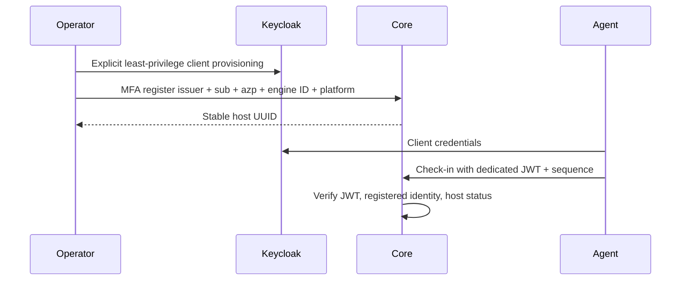

# Xarionix Deployment Agent

Отдельный процесс: `python -m scripts.deployment_agent`; отдельный Docker target:
`make deployment-agent-build`. Продуктовый Core image по умолчанию остаётся Core.
Agent image — UID 1000; при другом host UID нужен согласованный rootless запуск от
того же UID, которому принадлежит socket. Core socket агенту не подходит.

## Подготовка Linux-host

Нужны native rootless Docker, cgroup v2, systemd user-service с delegation CPU/memory/pids,
subuid/subgid, uidmap, TLS CA trust и приватный локальный каталог. Сверяйте
`docker info`: rootless + seccomp, CgroupVersion=2, MemoryLimit/SwapLimit/PidsLimit/CpuCfsQuota=true.
Agent дополнительно читает реальные memory.max/pids.max/cpu.max и /proc/self/status
из запущенного runtime. Нет enforcement — `isolation_unavailable`, не fallback.
Rootless DinD в обычном Docker Desktop/Runner часто не имеет delegation.

Read-only preflight без Core token и без запуска контейнеров:

```sh
python -m scripts.deployment_agent.preflight \
  --socket /run/user/1000/docker.sock --engine-id DAEMON_ID \
  --host-id REGISTERED_HOST_UUID --platform linux/amd64
```

Код 0 означает соответствие текущим требованиям daemon, код 2 — безопасный отказ с
коротким JSON code. Это не заменяет post-start kernel verification или регистрацию в Core.
В первом профиле capability negotiation фиксирован: protocol 1, одна pinned platform,
offline network и два resource profile; произвольные заявленные capabilities не дают прав.

Используйте отдельный daemon только для модулей Xarionix. Не выдавайте агенту системный
`/var/run/docker.sock`, Docker host TCP endpoint, группу rootful docker или sudo.
Настройка daemon/linger — явная административная операция, не действие Core.

## Identity и регистрация

В доверенном Keycloak создайте отдельный confidential client с Client Credentials,
`aud` ровно `xarionix-core-deployment`, подписанным claim
`xarionix_principal=deployment`, `sub` service account и `azp=client_id`.
Без password grant, человеческих client scopes, admin/service realm roles.
Это не регистрирует User, Membership или ModuleService в Core.



`POST /api/v1/platform/deployment-hosts` принимает:
`{id,name,issuer,subject,client_id,engine_id,platform}`. Issuer только настроенный
Core issuer, платформа linux/amd64 или linux/arm64, engine ID из отдельного daemon.
`GET /deployment-hosts` и `POST /deployment-hosts/{id}/enable|disable|revoke`
требуют Platform Admin/MFA; mutation требует `{expected_revision}`. Revoke terminal.

## Защищённая конфигурация

Префикс всех переменных `XARIONIX_DEPLOYMENT_`:

| Суффикс | Значение |
|---|---|
| CORE_URL | Публичный HTTPS Core без query/credentials |
| ISSUER | Точный публичный Keycloak issuer |
| CLIENT_ID / CLIENT_SECRET | Отдельный deployment client; секрет из protected environment |
| HOST_ID | Зарегистрированный UUID |
| ENGINE_SOCKET | Абсолютный Unix socket собственного rootless daemon |
| ENGINE_ID | Закреплённый daemon ID, не hostname |
| STORAGE_ROOT | Локальный durable каталог 0700, владелец UID агента |

Секрет не передают в argv, XPKG, CI artifact или HTTP runtime. Для systemd используйте
root-readable/agent-readable EnvironmentFile 0600, отдельный service account и journald
без raw HTTP/debug. Для контейнера — protected env-file вне Git и единственный разрешённый
socket bind; не монтировать host root или Core package volume. Каталог состояния персистентен.
Не очищайте SQLite при обычном restart: в нём sequence, поколения и ACK receipts.

`ISOLATED_HTTP=true` и `TEST_OIDC_TRANSPORT` существуют только для disposable localhost/
container tests, с фиксированным allowlist. Production TLS verification не отключается.
Агент не слушает входящие порты, discovery/token redirects запрещены, TLS проверяется.
