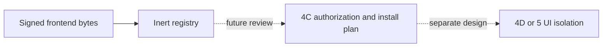

# Будущий Angular Module UI: граница доверия

В Sprint 4B frontend artifacts — только подписанные инертные байты под `payload/frontend/`.
Registry не публикует их как static files, не возвращает script URLs, не вставляет DOM, не меняет CSP
и не подключает Angular remote loader. Signature validity не даёт доступ к пользовательским JWT/cookies,
основному browser origin, Core DB, company context или API permissions.

До реализации UI runtime нужно отдельно выбрать: изолированный origin/sandbox, CSP, узкий messaging/API
contract, tenant scope, token handling, review/update/downgrade/rollback. Нельзя просто считать
доверенного publisher эквивалентом same-origin arbitrary JavaScript. Это не реализовано в 4B.
