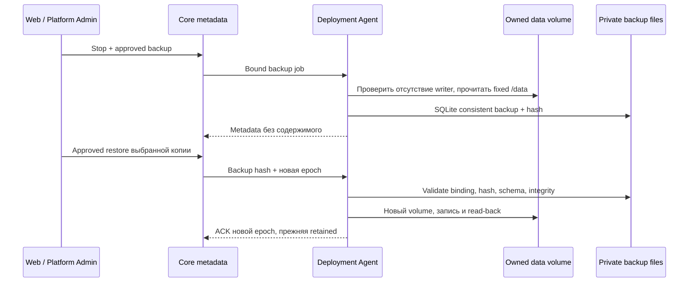

# Backup и restore данных модулей

Операции доступны через обычные deployment plans: `backup` и `restore`. Нужны
Platform Admin, свежий MFA и approval точного digest. Сначала writer должен быть
остановлен; Agent независимо проверяет отсутствие running containers установки.
Идентификаторы backup — UUID, пути не принимаются из Web или manifest.

Backup использует SQLite Backup API над проверенной offline-копией owned volume.
Проверяются integrity, owner marker, installation UUID и schema. В приватном Agent
каталоге сохраняются файл 0600 и bounded metadata: installation, epoch, schema,
package version, размер и SHA-256. Core сохраняет только metadata и job binding.
Создание не перезаписывает существующий backup. В Web: Runtime → Данные модуля.

Restore проверяет metadata и полный хэш до записи, а также поддержку schema целевым
пакетом. Запись выполняется в **новый** owned volume. Старый остаётся retained;
после read-back/integrity и ACK Core переключает активную epoch. Новый writer
запускается отдельным approved `start`. Restore более старого backup сознательно
возвращает данные на дату копии; новые записи сохраняются в retained epoch.

V1 хранит backups на том же Agent host. Для защиты от потери host администратор
должен резервировать приватный Agent storage root **и owned Docker data** штатным
средством host backup; copied files должны сохранять modes/ownership. Это не
удалённое зашифрованное backup-хранилище. Восстановление Agent journal и Core
metadata должно быть согласовано, простое копирование случайного SQLite-файла
поверх работающего writer не поддерживается.
