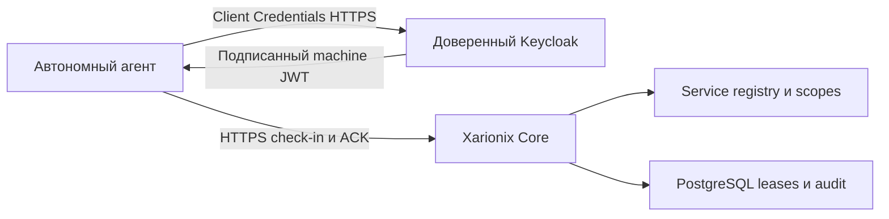
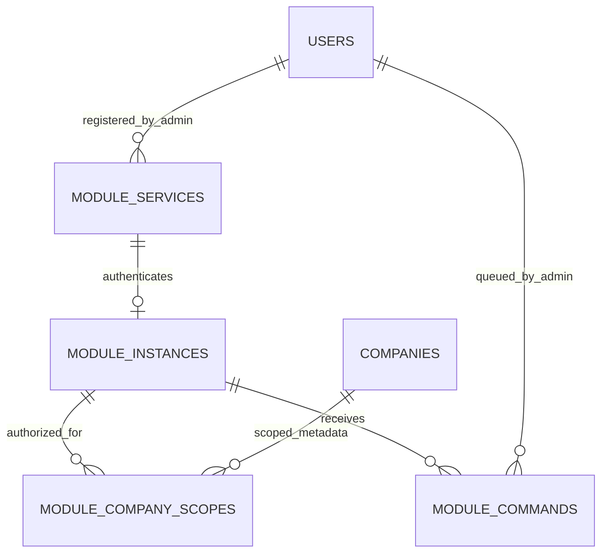

# Автономные модули — Sprint 4A

Sprint 4C связывает existing ModuleInstance с global installation **явным** audited binding:
instance UUID + exact package SHA + expected generation/binding revision. Одинакового module_key
недостаточно. Heartbeat/agent version/protocol остаются реальными данными 4A. При disable/uninstall
bound company metadata недоступна, но heartbeat/ACK и machine identity не отзываются автоматически.
Непривязанные legacy services сохраняют поведение 4A. [Module Manager](module-manager.md),
[безопасность и тестовый сценарий](sprint-4c-validation.md).

Это относится только к **никогда не привязывавшимся** instances. `installation_managed`
монотонно фиксирует explicit enrollment; после unbind или замены instance старый агент не
получает legacy fallback. Его company metadata требует действующего current binding и
availability установки; heartbeat/ACK при этом продолжают работать. Признак backfilled для
существующих bindings в 0010 и не может быть сброшен UPDATE или delete/reinsert.

Реализован control plane исходящего подключения, не универсальный бизнес-прокси и не Module Manager. Демонстрационный модуль — `scripts/module_agent.py`; у него нет входящего HTTP listener, Core DB credentials, Docker socket или Keycloak master-admin доступа.

## Сущности и доверие

`module_key` классифицирует тип (несколько service records могут иметь один тип). ModuleService UUID — отдельная явно зарегистрированная identity. ModuleInstance UUID — установленная копия с installation key и состоянием. В 4A unique service_id задаёт **одну service identity на один instance**. Несколько установок одного типа используют разные service accounts/bindings. Доверие по совпадающему имени не переносится.

ModuleCompanyScope имеет PK(instance_id,company_id), status и явные machine operations. Это не Membership или human Role. Сейчас company-scoped операция только читает минимальные metadata компании. `connect` не выдаёт `employees.manage`, Ownership или доступ к данным Billing.

## Фактические API

Prefix всех путей — `/api/v1`.

| API | Доступ |
|---|---|
| GET/POST `/platform/module-services`, GET `/{s}` | Platform Admin + текущий MFA |
| POST `/platform/module-services/{s}/enable`, `/disable`, `/revoke` | То же; revoke terminal |
| POST `/platform/module-services/{s}/instances` | То же; один instance на активный service |
| GET `/platform/module-instances`, `/{i}` | То же; pagination и derived state |
| POST `/platform/module-instances/{i}/enable`, `/disable`, `/revoke` | То же |
| PUT `/platform/module-instances/{i}/companies/{c}` | То же; явный scope |
| GET `/platform/module-instances/{i}/commands` | То же; pagination |
| POST `/platform/module-instances/{i}/commands/ping`, `/get_status` | То же; bounded queue |
| POST `/module-agent/check-in` | Отдельная Machine dependency |
| POST `/module-agent/commands/{id}/ack` | Machine + свой instance/command |
| GET `/module-agent/instances/{i}/companies/{c}` | Machine metadata.read + active company scope |

Списки: `items,total,limit,offset`. UUID, extra fields, lengths, enum capabilities, protocol и result проверяются Pydantic. Module JSON ограничен 16 KiB до DB acquisition, включая chunked body. API не принимает URL для callback/fetch и не обращается к модулю по сети.

## Business plane — только будущий контракт

Исходящий heartbeat не маршрутизирует браузер к автономному Billing за NAT. Понадобится отдельный business ingress/gateway или иной осознанный транспорт; reverse tunnel отсутствует. Core не обязан проксировать каждый бизнес-запрос.

Будущий on-behalf-of контракт должен независимо подтвердить пользовательский access token/audience, service identity и ограниченное делегирование, затем resource/company authorization. `user_id/company_id/permission` из JSON — не доказательство. OAuth token exchange, собственные пользовательские токены и межмодульный RPC в 4A не реализованы.

См. [service authentication](service-authentication.md), [control channel](module-control-channel.md), [threat model](module-threat-model.md), [проверки и upgrade](sprint-4a-validation.md).
