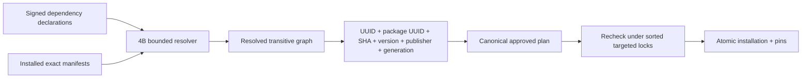

# Dependencies и exact pins

Используется resolver `packages.reports.dependencies` Sprint 4B и тот же SemVer parser.
Не добавлен второй алгоритм выбора версий. В known candidates попадают только существующие
установки с действующей authority и совместимостью. Registry без установки не удовлетворяет
зависимость и не устанавливается автоматически. Отчёт содержит missing/ambiguous/cycle причины.

Неоднозначность не решается произвольным newest. Успешный план фиксирует transitive closure,
не только прямую зависимость, с максимумом 32 pins. Смена generation/state/package/trust
до apply делает план stale. Permission availability проверяет pinned package UUID и текущую
доступность всех transitively pinned установок одним SQL-запросом, без ZIP и рекурсивного
Python resolver на каждый `/me`. Heartbeat проверяется по времени PostgreSQL.

Для install/enable/update/rollback зависимости должны быть enabled. Unknown или слишком большой
граф блокируется. Если у модуля есть установленные dependents, upgrade/rollback/uninstall
отклоняются даже при формально подходящем SemVer: 4C не переписывает чужие pins молча.
Процесс: отключить dependents → uninstall их metadata → изменить dependency → заново
подготовить/install/enable dependents. Пользовательские данные/история не удаляются.

Смена enable/disable поколения не переписывает package pin. Проверка текущего lifecycle и
authority всё равно обязательна; disabled dependency не может дать эффективные permissions.
Coordinated multi-module rollout и runtime compatibility относятся к 4D, не скрыты под
автоматическим перепривязыванием.
