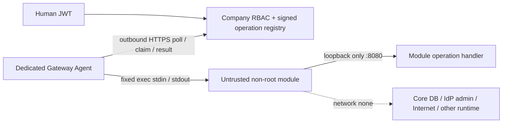

# Sprint 6A — аудит и решение до реализации

Baseline Core: `c6ab57707a0b2b486715017316e67d52b80b6d4e`. Оба рабочих дерева были
чистыми. Web и ERP не изменяются. `AGENTS.md` в рабочем каталоге отсутствует.

`rbac.authorization.effective` проверяет живые Membership/Role/RolePermission,
generation definitions, namespace и SQL `core_module_available`. Последний использует
`core_module_authorized`: installation, текущие publisher/key/grant, dependency pins,
успешный deployment job, digest, поколения и свежие host/health. Platform Admin не
даёт company business permission. Эти механизмы сохраняются.

Standard Module связан с package через ModuleInstallation; RuntimeDeployment связывает
его с host, package, generation и image. Autonomous использует отдельный
ModuleInstanceBinding. Deployment Agent получает только назначенные leased jobs,
проверяет fence перед действиями, независимо перепроверяет подписанный XPKG/OCI и
ACK. Его SQLite journal не является очередью бизнес-запросов.

Engine adapter проверяет rootless, dedicated daemon, cgroup v2, фактические CPU/RAM/
swap/PID/UID/caps/seccomp. Существующий runtime имеет network=none, health HTTP на
loopback:8080 и фиксированный exec probe. Ни Core, ни контейнер не получают engine
socket. Загрузка пакета проверяет весь signed inventory; canonical V1 signature
не меняется. Новый контракт — дополнительный inventory resource, без расширения V1
manifest и без автоматической активации legacy пакетов.

## Выбранные границы

Core ↔ отдельный Gateway Agent: bounded HTTPS long-poll relay. WebSocket потребовал
бы дополнительной библиотеки/инфраструктуры; HTTP/2 duplex — более сложного ASGI
контракта. Long-poll использует существующий HTTP/TLS стек, отдельную audience,
отдельную явно одобренную host identity и недолговечные sessions. Это только typed
operations; deployment jobs/ACK и durable request bodies не используются.

Локальный IPC: фиксированный Docker exec bridge с двунаправленным stdin/stdout,
обращающийся только к `127.0.0.1:8080/_xarionix/api/v1/{operation_id}` **внутри exact
owned runtime**. JSON передаётся через stdin, не через Cmd/env/файлы. Команда Python
постоянна, пользовательские shell/path/URL запрещены. Это осознанный opt-in профиль
`module-api-private-v1`, сохраняющий `NetworkMode=none`: ни bridge, ни host forwarding,
ни новый bind mount не нужны. Unix socket mount отвергнут из-за inode/restart/UID
mapping и увеличения filesystem capability. IP bridge без проверяемого egress policy
отвергнут. HTTP health contract остаётся прежним.

Цена IPC — один ограниченный exec на операцию, поэтому V1 не обещает throughput
постоянного сокета. Измерения обязательны. Gateway Agent находится в доверенной
deployment-зоне и использует узкий engine adapter; rootless daemon не защищает от
полностью скомпрометированного хоста. Контейнер не получает никакой socket capability.

## Threat model и concurrency

Недоверенные: browser headers/body, module package/process, сетевой peer до JWT,
устаревшие/повторные frames. Доверенные: Core, проверенный Agent, выделенный rootless
host/kernel и IdP. Нет remote attestation и exactly-once. Новые запросы проверяются
дважды (admission и dispatch); начавшуюся операцию concurrent revocation не откатывает.
После потери ответа mutating operation автоматически не повторяется.

Relay V1 — один Core worker с bounded in-memory queues; sessions привязаны к boot
epoch. Несколько workers не делят bodies и fail closed при отсутствии локальной
session. HA relay требует отдельного reviewed транспорта; PostgreSQL не служит
хранилищем бизнес-payload. Перезапуск Core теряет pending delivery с неопределённым
исходом и требует новой аутентифицированной session.

Проверены Web `projects/xarionix-console/src/app/core/api.ts`, `models.ts`,
`pages/install-plan.ts`, `pages/runtime.ts`, pinned OpenAPI и API contract doc.
Client использует human OIDC и company UUID routes; дополнительные поля install plan
не нарушают TypeScript interface (runtime validation с extra-forbid там нет).
**Private profile в существующем Web selector отсутствует**, там два offline profile;
для 6A нужен Core API/CLI workflow, UI/SDK Sprint 6B не реализуются. Backend OpenAPI
расширяется аддитивно, существующие routes/contracts не удаляются.
Web CI явно закрепляет `CONSOLE_CORE_REF=c6ab577…`; его exact snapshot check продолжает
проверять этот baseline. Если администратор переведёт Console на новый Core ref,
потребуются осознанная регенерация snapshot и UI review API approval/profile. Здесь
Web ref/snapshot не меняются и совместимость такого будущего переключения не заявляется.
