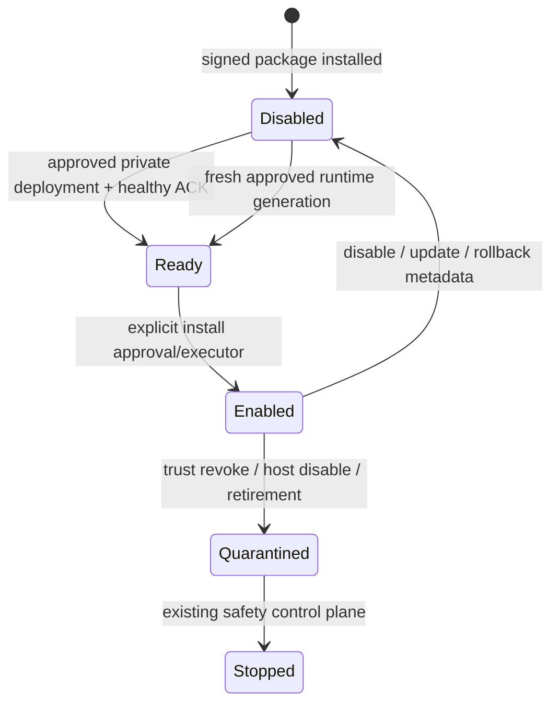

# Lifecycle и восстановление gateway

Enable API package требует verified metadata, approved private profile, active gateway
identity и healthy current deployment. Runtime protocol V1 включён в approval digest;
старый Agent не может молча принять неизвестный profile/Delivery и ACK.

Disable немедленно закрывает новый authorization. Existing deployment reconciliation
сохраняет свою политику safe stop; данные не удаляются, credential не отзывается
навсегда. Re-enable требует снова выполнить корректную readiness/approval sequence.
Upgrade и rollback связываются с exact package/API digest и новым runtime generation;
до совпадения старый контейнер не получает новый контракт. Старые grants не оживают.
Quarantine/retire не восстанавливают trust и не удаляют данные.

При Agent restart journal читается read-only, container не создаётся Gateway Agent.
При Core restart RAM sessions/pending requests теряются, Agent регистрирует новый
nonce. При timeout/disconnect/потере ответа исход записи **неизвестен**: сначала
проверить бизнес-состояние, не повторять write автоматически. В примере данные в RAM
модуля исчезают при замене/перезапуске самого module process — это ограничение demo.

Корреляция: API request UUID = module context UUID = audit request_id. Audit содержит
лишь actor/company/installation/operation/status/generation и связанный HTTP request ID.
Raw module errors, JWT, business body и responses не сохраняются.

Проверки выполняются только на disposable stack/daemon. Cleanup касается точных
owned host labels и сгенерированного Compose project, не global prune и не production
volumes. Если CI был принудительно убит и оставил runtime, preflight откажет на
непустом daemon: сначала проверить принадлежность контейнеров конкретному test host,
затем адресно остановить/удалить только их. Не обходить эту проверку.
