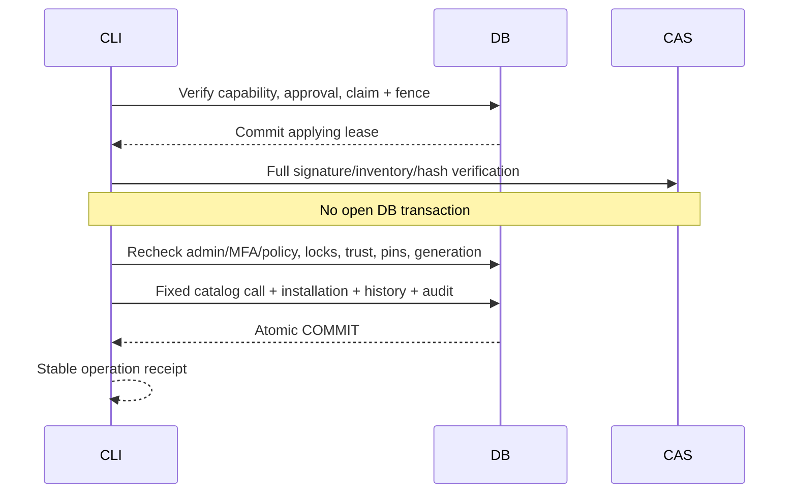

# Trusted operator executor

## Однократная подготовка DBA

Сначала примените `alembic upgrade head` отдельным мигратором. `0008_module_installations`
не создаёт LOGIN roles и не требует CREATEROLE. Без явного provision apply fail-closed.
Текущий head — `0010_instance_enrollment`; 0009/0010 также безопасно обновляют уже применённую 0008.
Сначала отделите owner/migrator/runtime согласно `runtime-database-roles.md`, затем создайте
отдельную restricted LOGIN `core_installer` с секретом через ваш защищённый DBA workflow.
Не используйте миграционный или Core runtime LOGIN для apply.

```sh
psql service=xarionix-maintenance -v runtime_role=core_runtime \
  -v installer_role=core_installer -f deploy/postgres/module-executor.sql
```

Секреты находятся в защищённом libpq service/passfile, не в команде. SQL идемпотентен,
проверяет предсуществующие роли, не меняет пароли и не отключает guards. Он создаёт две
NOLOGIN capability роли, передаёт владение **одной** функцией, выдаёт ограниченный набор
SELECT/installation DML/audit INSERT и отнимает EXECUTE у runtime/PUBLIC. Каталог permissions
не выдаётся installer на запись. Audit SELECT ограничен server timestamp для INSERT RETURNING.

CAS должен быть доступен исполнителю с тем же защищённым UID/правами, что проверяет Storage
Sprint 4B (обычно UID 10001 в отдельном operator job/container с тем же volume). Не делайте
`chmod 777`, не отключайте symlink/ownership проверки. Не монтируйте Docker Socket.
Operator использует отдельную защищённую конфигурацию Settings: те же issuer/MFA policy,
Core version/limits и CAS, но отдельные `XARIONIX_DB_USER/PASSWORD`. HTTP её не получает.

```sh
python -m scripts.module_manager list
python -m scripts.module_manager inspect --plan-id PLAN_UUID
python -m scripts.module_manager apply --plan-id PLAN_UUID --digest SAVED_SHA256
python -m scripts.module_manager reconcile
```

`list/inspect/reconcile` выполняются в READ ONLY transaction. Reconcile не применяет план и
не меняет leases. Ошибки CLI не печатают SQL/traceback/секреты; код причины доступен через
MFA-protected operation API. Completed apply возвращает тот же receipt даже после expiry.
Нельзя применять локально изменённый JSON: источником истины является сохранённый DB plan.



Locks: administration SHARE → sorted module keys (target EX/dependencies SHARE) → namespace EX
→ plan row → operation row. Existing administrative revocation uses administration EX and waits
only for короткую DB фазу. Hashing не удерживает эти locks. Разные модули могут проверяться
и применяться параллельно; совпадающий namespace/target сериализуется. Lease 180 секунд,
до 32 попыток, unique applying operation на module_id. Expired lease получает новый fence;
старый процесс не может зафиксировать результат.
