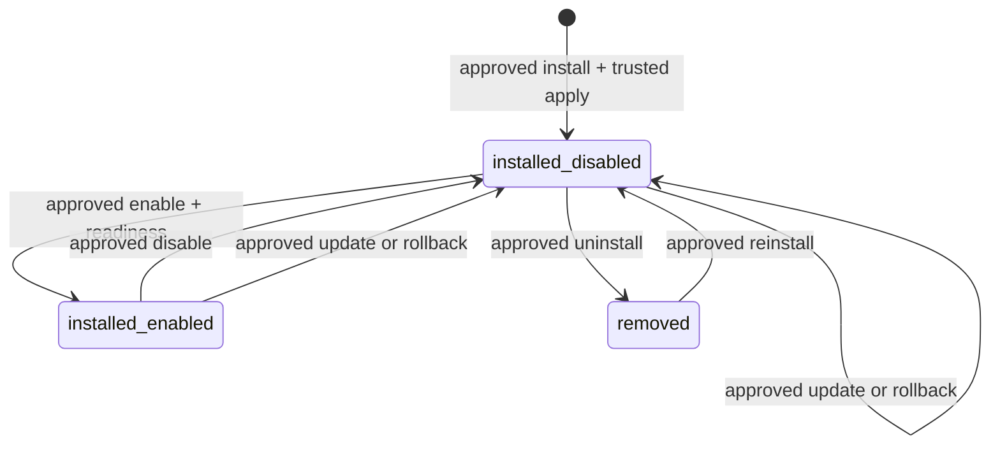

# Жизненный цикл глобальной установки

В 4D отдельно добавлен [runtime lifecycle](module-runtime-lifecycle.md). OCI installation
enable блокируется до healthy exact image/job/generation. Runtime provision/start не включает
namespace автоматически. Update/rollback остаются disabled до явного нового enable.
`POST /module-install-plans/{id}/refresh` создаёт новый план с текущим snapshot, full verify,
новым ID и без переноса approval. Terminal retire запрещает повторное enable/install.

Один module_id — один устойчивый installation UUID и один текущий package_id. Publisher,
namespace и module type не подменяются обновлением. Каждая успешная операция увеличивает
generation ровно на один; UUID/history/audit не удаляются.

| Действие | Реальное последствие |
|---|---|
| install | Фиксирует проверенный package и exact pins, регистрирует definitions; **disabled** |
| enable | Перепроверяет trust, зависимости, approval и поддерживаемую readiness; разрешает namespace |
| disable | Немедленно запрещает namespace/permissions; не отзывает service/instance identity |
| update | Меняет package, сохраняет предыдущий, обновляет definitions/epochs/pins; **disabled** |
| rollback | Только previous_package_id, с полными текущими проверками; **disabled** |
| uninstall | Только из disabled, деактивирует definitions и binding, очищает исходящие pins; **removed** |

Update/rollback намеренно требуют отдельного enable. Это staging metadata, не фиктивный
runtime upgrade. Rollback не возвращает выполненные DB migrations: модульные миграции,
контейнеры и frontend assets вообще не выполняются в 4C.

Reinstall использует прежний UUID, publisher и namespace, но новое поколение/approval.
Uninstall не удаляет внешние сервисы, tenant data, audit, registry blobs, service accounts,
commands или чужие зависимости. Уничтожение installation/history/TRUNCATE запрещено guards.
Binding после update/rollback/uninstall становится неактивным; для autonomous требуется
новая явная attestation точного package SHA. Старый агент не считается новой версией автоматически.

Если требуемый модуль имеет installed dependents, его update/rollback/uninstall запрещены.
Нужно явно убрать зависимые установки и подготовить их заново. Массового coordinated upgrade
в 4C нет. Disable запрещён при enabled dependents; сначала отключают зависимые модули.

Отозванный publisher/key/grant немедленно делает permissions недоступными. Обычные планы,
включая uninstall, требуют валидной текущей package authority; ключ не «включается обратно».
При терминальном отзыве сначала импортируют доверенное исправление под новым действующим
ключом и выполняют update, либо оставляют запись недоступной для дальнейшего DBA-разбора.
Новый ключ помогает только при отзыве ключа, если publisher и namespace authority остаются
действующими. Отзыв самого publisher или namespace grant в 4B терминален; такие installations
остаются недоступными с сохранённой историей. Автоматического re-grant или смены lineage нет.
Небезопасного `--skip-verification`/emergency DML пути не предусмотрено.
