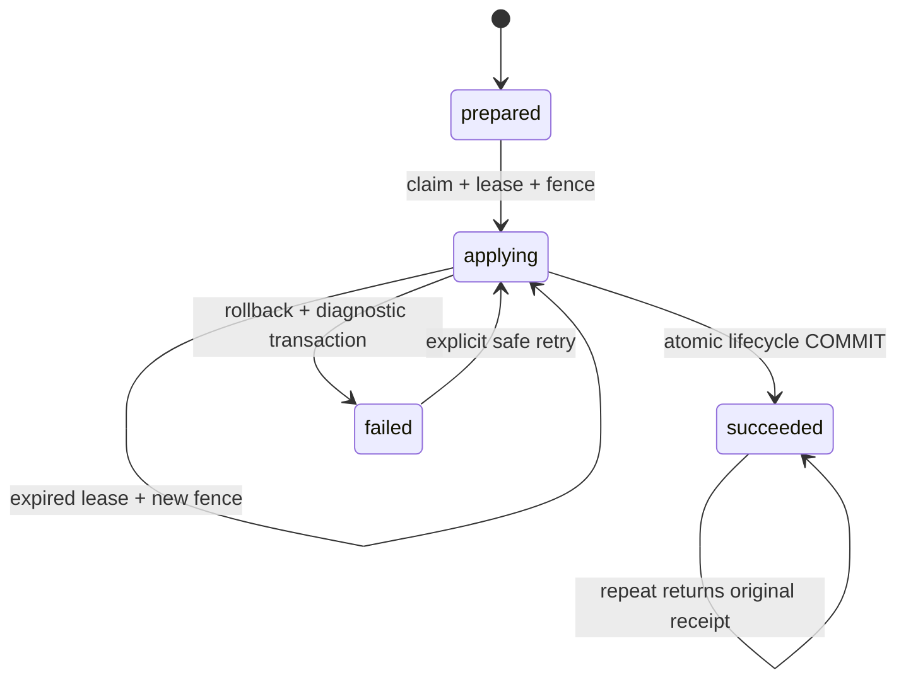

# Recovery, повторные операции и безопасный откат

DB и CAS не объявляются одной распределённой транзакцией. Пакеты уже находятся в immutable
CAS до установки; file work не меняет их, lease препятствует штатной maintenance cleanup.
Только lifecycle/catalog/pins/history/audit/succeeded фиксируются одной PostgreSQL transaction.

| Место отказа | Состояние и восстановление |
|---|---|
| До claim COMMIT | Никакого lifecycle эффекта; повторить после устранения причины |
| Во время verification | applying либо failed; каталог не изменён |
| После catalog, до COMMIT | Полный rollback, включая epochs/namespace/history |
| После COMMIT, до ответа | succeeded receipt; повтор не создаёт вторую историю |
| Убийство процесса | Lease остаётся в БД; дождаться истечения и повторить тот же план |
| Plan/approval expired | Новый snapshot и новое человеческое approval, не продлевать SQL |
| Trust/pins/generation изменились | Отказ stale; подготовить актуальный план |

`python -m scripts.module_manager reconcile` показывает applying/failed операции,
attempts, safe_error_code и lease. Команда READ ONLY, сама ничего не ремонтирует.
Для retry используется обычный apply того же UUID/digest; claims обновляются новым fence.
Конкурирующий старый исполнитель отклоняется. Если новый план заменяет abandoned operation,
expired операция помечается failed/lease_expired с audit, затем claim нового плана.

Не редактировать approval body/digest, не выключать guards, не переводить вручную succeeded,
не удалять history и не применять migration downgrade. Перед обновлением — проверенные
backup Core DB + CAS + Keycloak DB, процедура восстановления из installation.md.
Если нужен schema rollback, остановить writers и восстановить проверенный backup под
maintenance. Alembic downgrade новых 0008–0010 намеренно не выполняет destructive DDL.

Гарантия — idempotent DB transition и receipts, **не distributed exactly-once** исполнения.
В 4C внешнее исполнение отсутствует. Failure codes bounded/static, без JWT/секретов/SQL/path.
