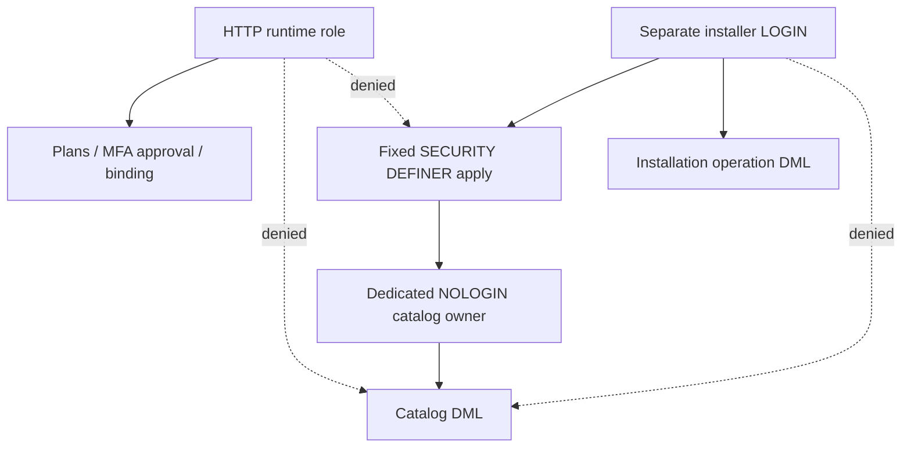

# Безопасность установки

Проверяются подписанные байты, inventory, SHA, immutable registry metadata, текущие publisher,
key и namespace grant, Core/protocol compatibility, namespace owner, exact dependencies,
generation, plan digest, approval policy/expiry, текущий active admin/human identity.
Выполнение shell/Python/JS из архива, import manifest entrypoint, module DB migrations,
Docker Socket, Keycloak Admin provisioning, лицензирование и автоматическая выдача прав отсутствуют.

Граница доверия — отдельная DB capability, не Python boolean и не GUC. Обычный runtime
не получает EXECUTE `core_apply_module_catalog`, catalog DML или membership executor role.
Функция принимает только UUID сохранённого плана, digest и fence; JSON/SQL от клиента не принимает.
Каталог читает definitions из immutable ModulePackage, не из произвольного plan JSON.
Функция дополнительно проверяет live operation, approval, package lineage и current trust.
Core namespace и чужой owner защищены row guard; существующий statement guard остаётся включённым.

Dedicated `xarionix_module_catalog` — NOLOGIN/NOSUPERUSER, без участников; он владеет
только фиксированной функцией, не таблицами/схемой. Другим ролям нельзя делать SET ROLE
в эту identity. Executor group — NOLOGIN, installer получает INHERIT, но не ADMIN/SET.
Runtime-settable GUC не влияет на guards. DBA SQL использует GUC только для временной
проверки несекретных имён ролей при bootstrap, не для выполнения installation/catalog DML.

Использованы рекомендации PostgreSQL о [SECURITY DEFINER и search_path](https://www.postgresql.org/docs/18/sql-createfunction.html)
и [role membership](https://www.postgresql.org/docs/18/role-membership.html). PUBLIC EXECUTE
отозван, имена таблиц в definer-функции schema-qualified. PUBLIC CREATE в схеме должен быть отозван.

## Остаточный риск существующего dev

Legacy `core_app` по-прежнему владеет таблицами development DB. Triggers запрещают прямой DML,
но владелец потенциально может менять DDL/отключать triggers. Это **не** эквивалент production
разделению owner/migrator/runtime. Credentials, ownership и имеющиеся volumes автоматически
не изменяются. Перед production обязательна DBA-процедура из `runtime-database-roles.md` и
отдельный installer bootstrap. Суперпользователь/мигратор остаются доверенной maintenance-зоной.

Полный compromise HTTP DB credentials не является надёжным доказательством человеческого approval:
runtime пишет административный workflow по проверенной JWT identity. Operator обязан сверять
UUID/digest/состав плана перед apply; CLI не принимает произвольный browser-supplied plan.
Секреты не передают в argv, artifacts, журнал операций или пакет.
