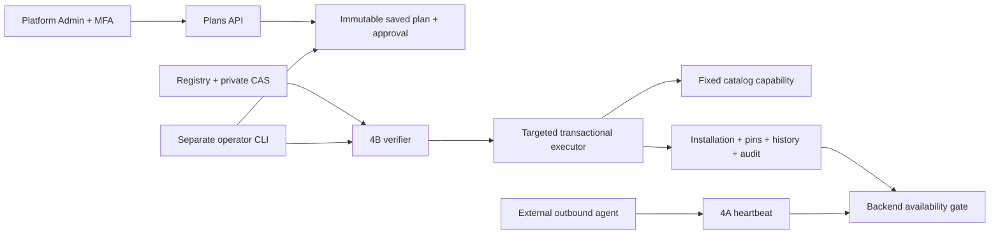

# Module Manager — Sprint 4C

Дополнение 4D: [runtime control plane](module-runtime.md) не меняет перечисленные ниже
каталожные полномочия. Install plan и deployment plan различаются; только отдельный агент
выполняет bounded OCI deployment. Новый plan refresh создаёт новый nonce/expiry и требует
новой approval, а не продлевает старую. Retire не возвращает revoked trust.

Module Manager — глобальный control plane внутри модульного монолита. Он не является
контейнерным оркестратором, сервером лицензирования или исполнителем содержимого `.xpkg`.
Registry/import, installation, platform availability, provisioning и реальное соединение
с агентом — разные факты. Установки не принадлежат компаниям; RBAC остаётся company-scoped.

## Аудит и выбранная граница

База аудита: `e1eea1a671c2f77d96bd31d841cb8176b1f32051`. Используются verifier/CAS,
SemVer/resolver Sprint 4B, machine binding/heartbeat Sprint 4A, MFA и RBAC Sprint 3.
Ранее импорт **не** регистрировал permissions; `core_catalog_guard` запрещал любой
runtime DML каталога. Это ограничение сохранено. Новый HTTP router не импортирует executor
и не получает миграционные/installer credentials. Старые миграции не изменены.

## Фактические компоненты

- `app/domains/installations/model.py`: шесть таблиц, без дублирования manifest.
- `policy.py`: state machine, bounded policy fingerprint, domain-separated canonical digest.
- `service.py`: snapshots, plans, approval, binding, безопасные read models.
- `executor.py`: claim/lease/fence, повторная проверка, атомарный apply и диагностика.
- `app/api/v1/installations.py`: только административные control/read endpoints.
- `scripts/module_manager.py`: отдельный operator entry point.
- `0008_module_installations`: additive schema, guards и фиксированные SQL-функции.
- `0009_catalog_read_checks`: epoch guard работает с SELECT-only каталогом, без выдачи UPDATE runtime.
- `0010_instance_enrollment`: ранее привязанный агент не возвращается в legacy authority после unbind/rebind.

## HTTP API

Все маршруты имеют prefix `/api/v1/platform`, требуют активного human Platform Admin и
свежей настроенной MFA; Company Owner и machine JWT недостаточны.

| Метод | Маршрут | Назначение |
|---|---|---|
| POST | `/module-install-plans` | Подготовить серверный план |
| GET | `/module-install-plans/{id}` | Проверить точный digest/состав |
| POST | `/module-install-plans/{id}/approve` | Подтвердить `{digest}` |
| POST | `/module-install-plans/{id}/cancel` | Отменить `{digest}` |
| GET | `/module-installations[/{id}]` | Установки и реальный runtime state |
| GET | `/module-installations/{id}/history` | История поколений |
| GET | `/module-install-operations[/{id}]` | Результаты и безопасные коды ошибок |
| POST | `/module-installations/{id}/bind-instance` | Явно связать/отвязать агент |

List endpoints: `limit=1..100`, `offset=0..100000`, стабильный порядок и `total`.
JSON bodies ограничены 16 KiB до открытия DB transaction. Лишние поля запрещены.
Создание: `{action, package_id, expected_generation: 0, idempotency_key?: UUID}`.
Для существующей установки требуется её текущее поколение. Повтор подготовки с тем же
idempotency key и неизменившимся snapshot возвращает тот же план. После mutation старый
snapshot уже не актуален: результат читают через GET плана/operation, а не повторяют подготовку.

План живёт 600 секунд. Approval ограничен одновременно expires_at и сроком свежести MFA.
В БД нет JWT: только actor/identity UUID, digest, acr, auth_time и policy fingerprint.
Runtime capability не возникает из произвольных флагов manifest. Standard resources-only
пакет допускается как **metadata_only**, но runtime у него всё равно `not_provisioned`.
Standard backend/frontend runtime не поддерживается и enable блокируется.

Ограничения resolver: 256 установленных кандидатов, 32 exact transitive pins;
сложный/слишком большой граф отклоняется, а не разрешается частично.
На namespace допускается до 2048 исторических permission keys (manifest V1 — до 100
текущих definitions). Превышение отклоняется без удаления прежних FK/назначений.
