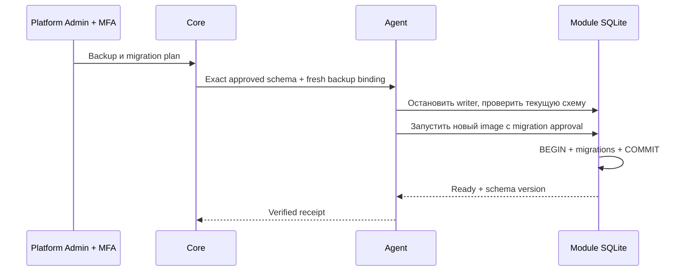
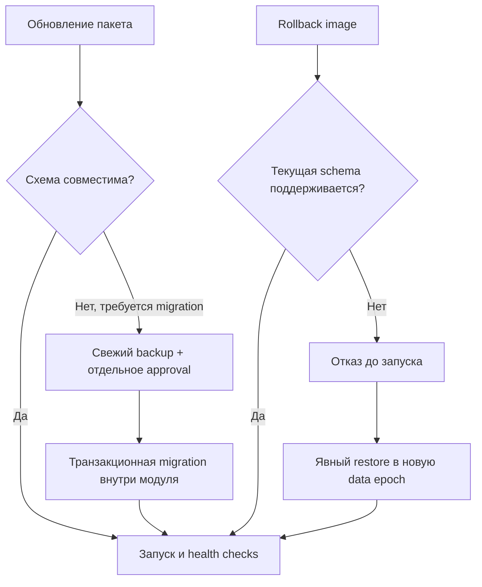

# Миграции данных модуля

Миграции принадлежат SDK-модулю и выполняются внутри его изолированного runtime.
Core не импортирует Python из пакета и не выполняет uploaded SQL. В signed SDK
metadata входят последовательные номера и SHA-256 migrations. Пакет и OCI image
содержат одинаковую декларацию. Hello Business проверяет её перед открытием БД.

1. Загрузить проверенный новый `.xpkg`, создать и утвердить Install Plan.
2. Остановить writer. Создать и утвердить deployment `backup`.
3. Подготовить `upgrade` с `backup_id` и `allow_migration=true`.
4. Проверить digest и подтвердить свежим MFA. Backup должен соответствовать
   installation, epoch, текущей schema и allocation revision.
5. Agent проверяет сохранённую БД и backup, останавливает предыдущий runtime,
   запускает exact approved image. SDK выполняет migrations одной транзакцией.
6. Только успешные health/schema checks и ACK разрешают Gateway доступ.

SDK запрещает ATTACH/DETACH, extension loading, изменение journal policy и
самостоятельный COMMIT/ROLLBACK внутри migration. При исключении транзакция
откатывается. Statement cache отключён: ранее скомпилированный COMMIT не обходит
SQLite authorizer. Проверяются integrity и schema compatibility.

Откат image не означает откат данных. Несовместимый `rollback` запрещён до запуска.
Нужно явно восстановить совместимый backup в новую epoch и затем запустить прежний
пакет. Если migration уже committed, а readiness не прошёл, данные автоматически
не откатываются: runtime закрыт для Gateway; оператор проверяет состояние через
`inspect`, затем выбирает исправление или restore. Нельзя обещать атомарность между
SQLite COMMIT и Core ACK через сеть.

