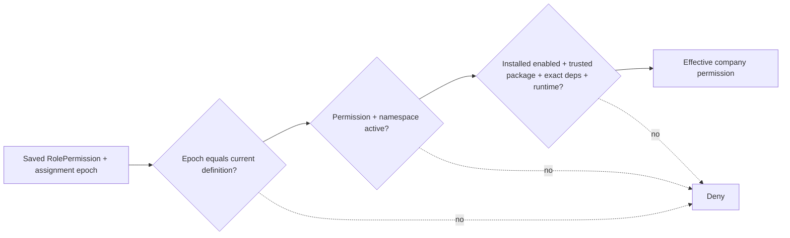

# Активация module permissions

Manifest V1 содержит namespace, keys, description и company scope. Он не содержит доверенных
`protected`, `owner_grantable`, admin roles или machine operations. Reviewed installer policy
задаёт для модульных definitions `protected=false`, `owner_grantable=true`; core неизменяем.
Namespace owner — module_id, publisher определяется immutable package lineage и grant.
Reserved erp/oss/billing сохраняют владельцев xarionix-erp/xarionix-oss/xarionix-billing.

Никаких автоматических grants: установка не меняет RolePermissions, MembershipRoles,
Invitations или PermissionDelegations. Existing finite system roles не расширяются.
Company Owner явно назначает доступные модульные permissions существующим RBAC API.

Каждой definition соответствует монотонная `definition_generation`, каждой записи
RolePermission/PermissionDelegation — `permission_generation`. Legacy core rows backfilled
значением 1; прежние role UUID/FK не меняются.

- Disable: namespace недоступен, assignments сохранены. Approved enable может восстановить
  **неизменённые** легитимные grants — это явное ожидаемое действие администратора.
- Update unchanged definition: epoch/grants сохраняются.
- Modified/removed definition: epoch увеличивается, старый grant остаётся для истории,
  но не даёт effective permission. Удалённая definition становится inactive, не DELETE.
- Rollback/reintroduction: старое значение description не возвращает старый epoch.
- Uninstall/reinstall: definitions деактивируются/получают новый epoch; старые grants не оживают.
- Явное последующее сохранение permissions роли/делегирования записывает текущий epoch
  после обычных authorization checks. Удаление недоступных старых grants допускается.

DB trigger проверяет epoch при новых assignments. Исторические FK не ослаблены. Список
сохранённых grants роли может включать устаревший key; effective engine его не учитывает.
Отзыв publisher/key/grant и потеря heartbeat автономного bound agent тоже fail-closed.
Company metadata endpoints bound machine отказывают при недоступной установке; heartbeat
и ACK продолжают работать для диагностики/reconnect. Старые **непривязанные** 4A services
сохраняют прежнее поведение только до первого explicit enrollment; совпадение module_key
не создаёт binding. После unbind/rebind `installation_managed` предотвращает legacy fallback.
