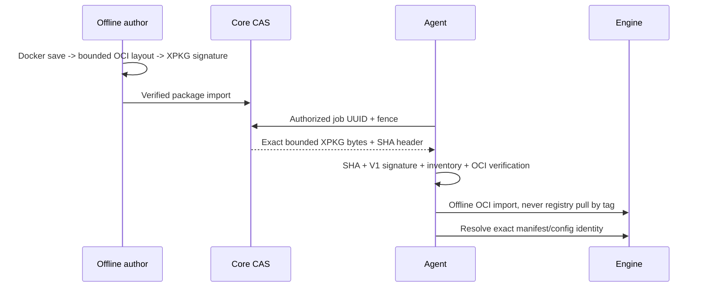

# Offline OCI runtime profile V1

Это профиль **внутри XPKG V1**, а не несовместимое изменение его manifest/signature.
Исторические inert packages, canonical JSON и test vectors не изменены.
Лимиты прежние: package 128 MiB, один inventory artifact 32 MiB, суммарно 256 MiB.
Large ERP image, не помещающийся в профиль, должен быть отклонён; V2/blob transport — позже.

Подписанный inventory содержит ровно:

```text
payload/resources/runtime-v1.json
payload/backend/oci/oci-layout
payload/backend/oci/index.json
payload/backend/oci/blobs/sha256/<manifest>
payload/backend/oci/blobs/sha256/<config>
payload/backend/oci/blobs/sha256/<layers>
```

Runtime JSON имеет закрытую схему: schema_version=1, engine=oci, platform,
image_digest (OCI manifest), config_digest, health_contract=http-python-v1, health_port=8080.
Нет entrypoint override, URL, registry tag, env, mounts, Docker flags или shell.
Entry point — часть подписанного image config; Core его никогда не выполняет.
Обязательны fixed Python probe и non-root runtime user 10001.

Проверяются index/manifest/config, точные SHA/размеры каждого blob, platform, отсутствие
Volumes/OnBuild/foreign descriptors, diff_ids и bounded распаковка gzip layers. OCI JSON
разрешает escaped newlines в image history, но имеет отдельные depth/size/collection limits.
Это не ослабляет canonical JSON подписанного XPKG manifest. Никакой extractall в Core.



Docker classic store использует config digest как image ID, containerd store — manifest digest.
Adapter принимает только эти криптографически связанные значения и перепроверяет Descriptor
при его наличии. Mutable tag не используется для deployment.
Resume/range в первом bounded transport не реализован: retry повторно проверяет весь пакет.
Read-only API не принимает произвольный path. Package staging и SQLite — приватные, без JWT.
