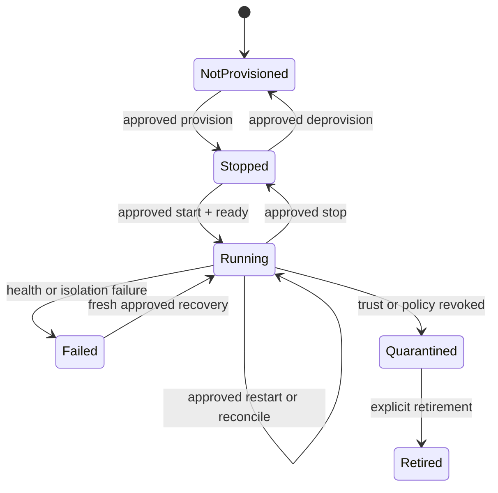
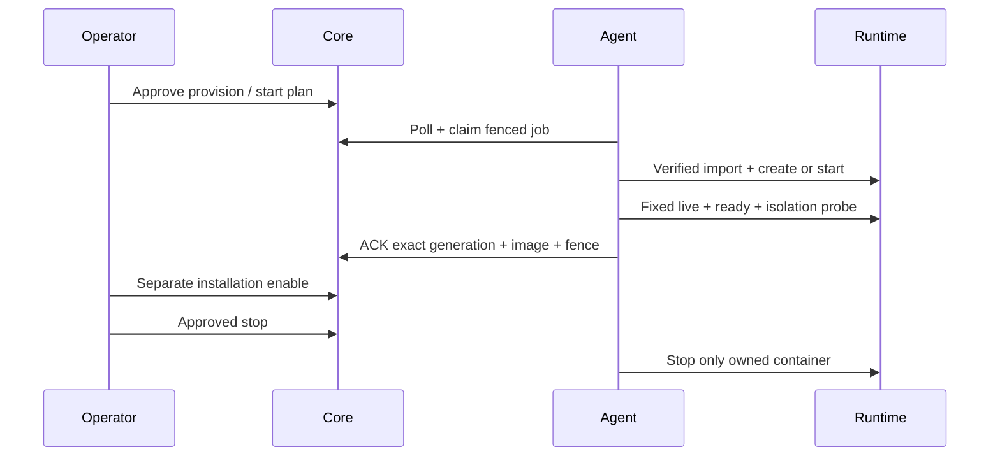
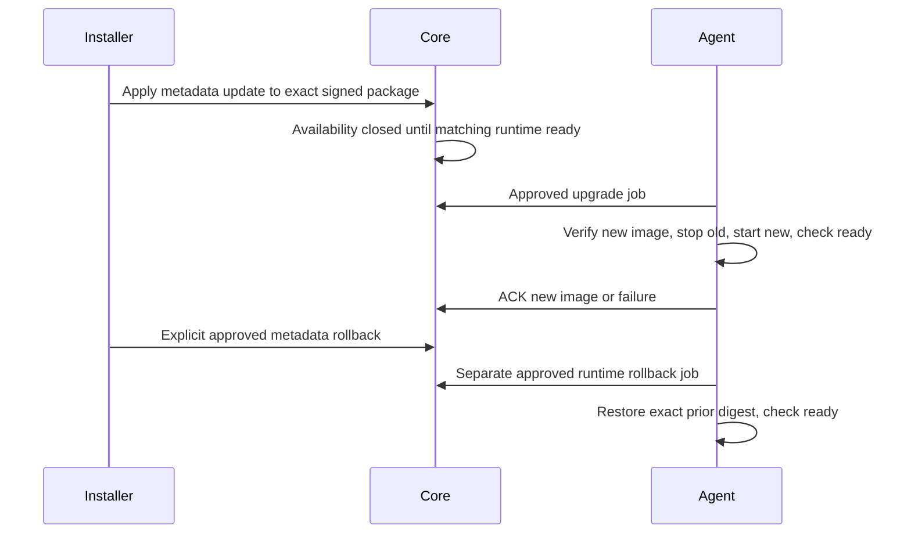

# Installation и runtime lifecycle



Сначала 4C install plan, approve и trusted executor apply. Затем отдельный
`POST /api/v1/platform/deployment-plans`:

```json
{
  "idempotency_key": "00000000-0000-4000-8000-000000000001",
  "installation_id": "00000000-0000-4000-8000-000000000002",
  "host_id": "00000000-0000-4000-8000-000000000003",
  "operation": "start",
  "expected_installation_generation": 1,
  "expected_deployment_generation": 0,
  "profile": "offline-small-v1"
}
```

UUID здесь только пример структуры, не реальные объекты. Проверьте серверный body/digest,
подтвердите через `/deployment-plans/{id}/approve` с `{digest}` и свежим MFA.
Поддержаны provision/start/stop/restart/upgrade/rollback/deprovision/inspect/reconcile/
quarantine/retire. GET plan, cancel pending, runtime list и paginated job history доступны
в том же Platform Admin API. Повтор approve applied plan возвращает исходное job ID.

Provision создаёт stopped container; start ждёт liveness/readiness. Только после healthy
разрешён отдельный 4C enable. Stop не удаляет package/catalog/history. Deprovision требует
сначала observed stopped и удаляет только помеченные runtime containers без `-v`.
В текущем offline profile пользовательских persistent mounts нет.





Нет автоматического восстановления trust или отката DB migrations. Неуспешный upgrade
оставляет fail-closed state; rollback требует новой проверки package и одобрения.
`inspect` не создаёт и не запускает отсутствующий контейнер. Restart также не provision.
