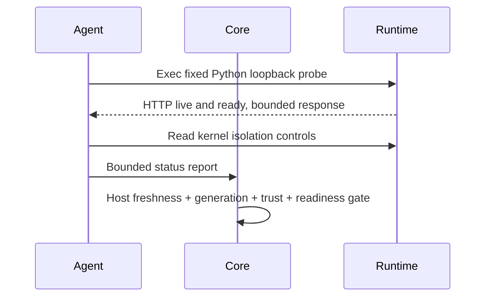

# Runtime networking и health

Первый production profile намеренно **offline**: `NetworkMode=none`, без host ports,
Docker/Compose/DB networks и маршрутов к Core/Keycloak/Internet. Пересылка business API
из OCI-модуля в этом профиле не реализована; для неё нужен отдельный reviewed network
contract, а не включение host network или прокидывание deployment token.

Deployment Agent имеет outbound HTTPS к Core и настроенному IdP; входящий порт не нужен.
OIDC discovery привязан к одному issuer, token endpoint проверяется, redirects запрещены,
сертификаты проверяются системным trust store. HTTP допустим только в явно включённых
disposable localhost/container tests; production не переключается на него автоматически.

`/health/live` и `/health/ready` внутри runtime слушают 8080; agent проверяет их через
фиксированный Python health contract, а не HTTP через host network. Успешный probe
без stdout корректен: доказательство успеха — завершившийся exec с exit=0, не наличие текста.
Нет произвольного probe URL/SSRF и пользовательского shell healthcheck.
Hello `/version` демонстрирует смену версии. Файл `/tmp/not-ready` даёт readiness=503
для fault injection в изолированном тесте, без доступа к production данным.

Все health details наружу — безопасные статусы, времена, restart count и error code.
Raw stderr, токены, image environment и Docker diagnostic JSON в Core reports не передаются.
