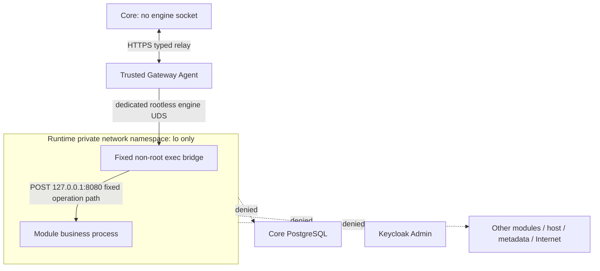

# module-api-private-v1: IPC без сетевого egress

Это **opt-in** server-approved deployment profile. Старые `offline-small-v1` и
`offline-medium-v1` не меняются. Private API profile сохраняет `NetworkMode=none`;
он не обозначает подключение к Docker bridge. Ресурсы как у small: RAM=256 MiB,
swap=0, CPU=0.5, PID=64, private tmpfs=64 MiB.

Agent выбирает exact owned runtime по своему verified journal и pinned host/engine/
installation/image/generation. Browser не передаёт container ID. Engine adapter
проверяет rootless, dedicated daemon, non-root UID10001, readonly, cap-drop ALL,
no-new-privileges, seccomp, private cgroup/IPC, реальные CPU/RAM/swap/PID controls.
Для private profile дополнительно inspect требует только сеть none, отсутствие
published ports/binds/mounts; namespace probe требует только lo и отсутствие engine
socket. Проверки выполняются после start, при report и перед business call.
Enforcement failure останавливает новый runtime; нет fallback на bridge/host.

Внутренний фиксированный Python bridge отправляет POST только на
`127.0.0.1:8080/_xarionix/api/v1/{validated_operation_id}`. JSON содержит context/body,
транспорт — exec hijacked stdin/stdout с length framing. Cmd постоянна; body не
записывается в Cmd/env/files/обычные container logs. stdin/HTTP/output ограничены;
alarm ≤16s ограничивает оставшийся bridge после disconnect. Docker API hijack описан
в [официальном Engine API](https://docs.docker.com/reference/api/engine/version/v1.51/).

Это проверяемый IPC, не host loopback publication. Ни порт8080, ни engine UDS не
монтируются/публикуются модулю. Runtime не получает Core/IdP/Agent secrets или mounts.
`http-python-v1` GET health live/ready остаётся совместимым.

Rootless daemon/kernel/Agent — доверенная deployment-зона, не VM sandbox и не remote
attestation. Не запускайте посторонние workloads в pinned daemon. Gateway Agent
пользуется тем же ограниченным engine adapter и read-only journal; выдача произвольного
доступа к этому daemon стороннему процессу выходит за эту границу доверия.

Цена V1: фиксированный exec на операцию и повторная inspection, ощутимые на удалённом
test daemon. Длительный локальный IPC и HA relay требуют отдельного reviewed этапа,
не ослабления namespace или пропуска post-inspect.
