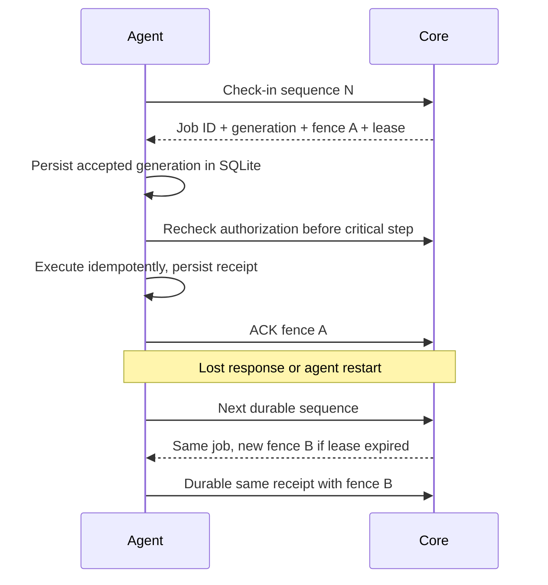
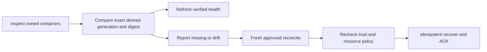
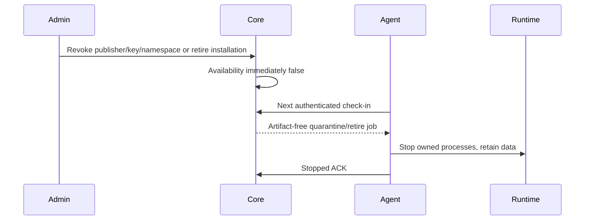

# Recovery, delivery и отзыв доверия

Job delivery — at-least-once. UUID стабилен, generation монотонен, lease 120 секунд,
fence меняется при повторной выдаче, максимум 8 attempts, срок не дольше approval.
Plan живёт 600 секунд и дополнительно ограничен MFA freshness. После expiry нужен новый
план и новое подтверждение; продление старой approval не допускается.

SQLite имеет exclusive writer flock, WAL и FULL synchronous; credentials в нём не хранятся.
Каждая installation имеет собственные `installations/<UUID>/cache` и `data` под 0700.
V1 runtime stateless: data directory не монтируется в контейнер и не удаляется cleanup.
Staging очищается после receipt и при restart, затем пакет проверяется заново.
Expiry не подтверждённого execution job создаёт artifact-free quarantine нового поколения;
поздний ACK старого поколения не может вернуть availability.
Не запускайте два агента с одним STORAGE_ROOT. После падения журнал сохраняет sequence,
последнее поколение и receipt. Deterministic container identity предотвращает дубликаты.
Частичный package staging не исполняется: доставка повторяет полную проверку байтов.
После healthy deployment сохраняются active и один предыдущий stopped container.
Более старые rollback images повторно импортируются из подписанного CAS. GC адресует только
owned stopped containers и их неиспользуемые images: без force/prune/удаления volumes.

Safe retirement: `POST /api/v1/platform/module-installations/{id}/retire` с
`{expected_installation_generation,state: quarantined|retired}`. Это отдельный terminal
security flag, не восстановление revoked key/grant и не обход catalog executor.
После остановки можно approved deprovision без возвращения trust. Аудит/установка/пакеты
сохраняются. Revoked host не получает jobs; authentication rejection приводит к локальной
остановке собственных runtime. Недоступный host физически нельзя остановить из Core.

Сохраняйте backup Core DB + XPKG CAS + agent journal отдельно и согласованно. Нельзя
сбрасывать host sequence или переиспользовать host UUID с новым daemon без явной процедуры.
При ручном drift/утрате daemon ID восстановите host под новой identity через администратора;
автоматического перепривязывания к случайному engine нет.
