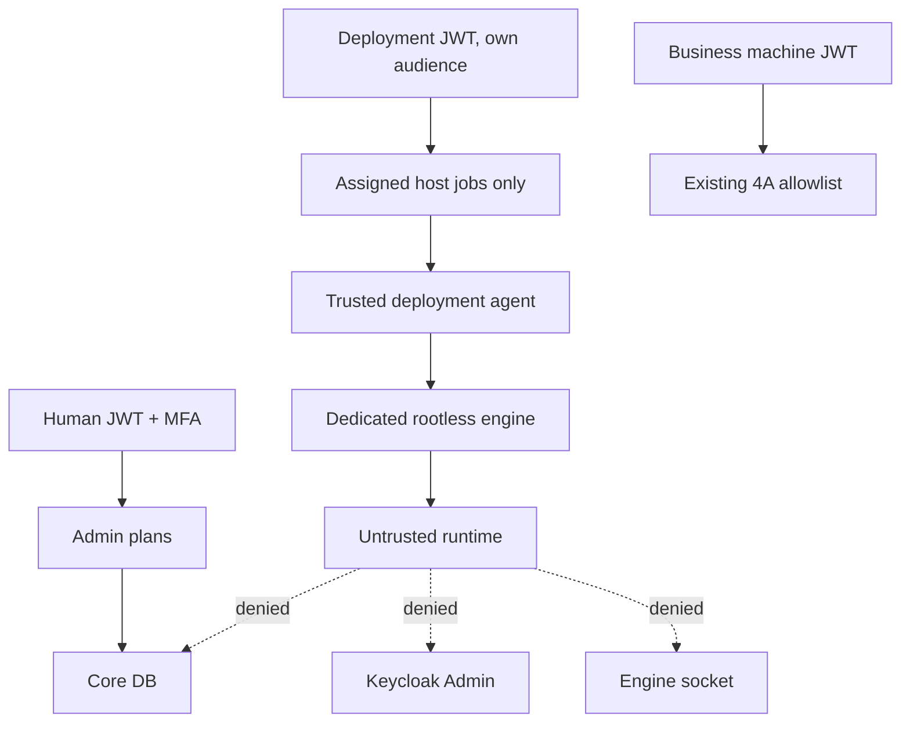

# Runtime security boundaries

Agent/engine — доверенная deployment-зона. Rootless снижает последствия engine compromise,
но не делает hostile workloads VM-изолированными. Не размещайте посторонние контейнеры в этом
daemon. Compromised deployment host может ложно сообщить health; TLS/JWT не являются remote
attestation ядра. Это явная граница доверия, а не обещание абсолютной защиты.

Runtime profile: UID/GID 10001, readonly rootfs, cap-drop ALL, no-new-privileges, builtin
seccomp, private cgroup namespace, IPC none, network none, без PID host/devices/binds/volumes/
ports/socket/secrets. Только private tmpfs /tmp с noexec,nosuid,nodev. Профили:

| Профиль | RAM + swap cap | CPU | PID | tmpfs |
|---|---|---|---|---|
| offline-small-v1 | 256 MiB / swap disabled | 0.5 | 64 | 64 MiB |
| offline-medium-v1 | 512 MiB / swap disabled | 1 | 128 | 64 MiB |

Неподдерживаемые лимиты не игнорируются. Inspect сравнивает конфигурацию с профилем;
запущенный probe проверяет реальные cgroups/UID/caps/seccomp. Ошибка проверки после start
останавливает новый runtime, не оставляя неподтверждённый процесс. Логи ограничены 1 MiB × 2,
on-failure restart максимум 3. Health probes имеют фиксированный loopback endpoint и timeout.

Availability требует текущего trusted publisher/key/namespace, exact installed package,
успешного job того же поколения/image, active/fresh host и fresh ready+live. Frontend
contribution остаётся inert metadata, browser не получает доверие из healthy image.

Host disable, trust revoke, retirement немедленно закрывают authorization; физическая
остановка выполняется при следующем доступном check-in. Это не синхронная остановка
отключённого от сети сервера. На authentication rejection агент локально останавливает
свои runtime, но не удаляет данные. Revoke не восстанавливается ради cleanup.

DB owner/migrator/installer credentials, произвольные commands, DDL, Keycloak admin API,
commercial licensing и учёт ресурсов пользователя не входят в runtime contract.
