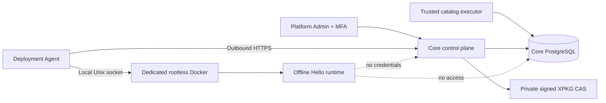

# Изолированный runtime — Sprint 4D

6A добавляет opt-in `module-api-private-v1` с [фиксированным IPC](module-runtime-private-network.md)
и signed API resource. Старые offline profiles/health contract не меняются; network=none
сохранён. Business вызовы идут через [Core Gateway](module-api-gateway.md), требуют
company RBAC и не используют deployment jobs как очередь запросов.

Installation и runtime — разные факты. Импорт XPKG не запускает образ; применённый
install plan не означает готовность сервиса; healthy runtime сам по себе не выдаёт RBAC.
Standard OCI-модуль выполняется отдельным Deployment Agent на явно назначенном host.
Autonomous 4A Module Agent остаётся отдельной identity с прежними ping/get_status.

Новые сущности: DeploymentHost, DeploymentPlan, RuntimeDeployment, DeploymentJob,
ModuleRetirement. Одна installation закрепляется за одним host; автоматической миграции
между hosts или scheduler нет. На host максимум 32 установки, 32 активных задания,
одна доставка за check-in, один download/start на агенте. Каталог и execution history
не удаляются при deprovision.

Обязательная граница: Core не импортирует engine adapter, не получает Docker socket,
installer/migrator credentials и не выполняет package code. Agent не получает SQL,
Keycloak Admin, человеческие или бизнес-модульные credentials. Runtime не получает
даже deployment credentials.

Начните с [development](module-runtime-development.md), затем
[host/agent](deployment-agent.md), [lifecycle](module-runtime-lifecycle.md),
[security](module-runtime-security.md) и [проверок](sprint-4d-validation.md).
