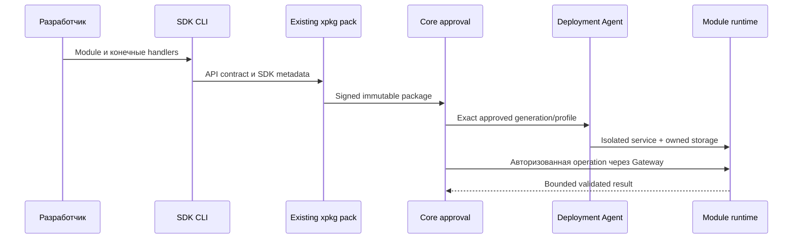

# Module SDK V1 — решение Sprint 6B

## Проверенная граница Sprint 6A

Gateway передаёт только signed operation ID, ограниченный JSON и созданный Core
ExecutionContext. Контракт `module-api-v1.json` закрыт: schema_version=1,
POST operations, permission из manifest namespace, request/response JSON bounds.
Agent исполняет постоянный stdin/stdout bridge к loopback HTTP:8080 внутри
network=none контейнера. Human JWT, произвольные URL, команды и пути отсутствуют.
Это сохраняется без изменения public operation endpoint.

## SDK

Отдельный устанавливаемый Python package `sdk/python`, без импорта Core/agent,
SQL credentials и административного клиента. `Module` регистрирует конечный
набор handlers; `ModuleContext` содержит typed UUID, actor, deadline и generation.
SDK проверяет версии, operation/permission, JSON limits, декларативные schemas,
deadline до/после выполнения и возвращает безопасные ошибки. Логи содержат
request ID и код результата, не payload/токены. HTTP service предоставляет
совместимые health/version и business operations, с ограниченной конкуренцией
и graceful shutdown.

CLI проверяет module entry point и генерирует:

- `module-api-v1.json`: неизменённый signed API V1 контракт.
- `module-sdk-v1.json`: identity/version/namespace, protocol и schemas handlers.

Оба файла входят в inventory обычного `.xpkg`; используется существующий
Ed25519 pack/verify. SDK не подписывает самостоятельно и не добавляет permissions
во время исполнения. Metadata не содержит executable paths из запроса.

## Stateful профиль

Новый opt-in профиль должен добавлять ровно одно owned data storage к сохранённым
rootless/non-root/read-only/seccomp/no-egress/digest/resource safeguards. Identity
хранилища определяется installation UUID, не manifest path. Stop/restart/update/
rollback/deprovision/uninstall не удаляют business data. Смена writer допустима
только после остановки предыдущего и проверки schema compatibility.

SQLite находится в приватном persistent directory. Migrations транзакционны и
исполняются внутри module boundary; backup консистентен и имеет installation,
schema, version и SHA-256 metadata. Restore только при остановленном writer и
после проверки полного backup. Публичного data deletion API в этом Sprint нет.
SQLite V1 не является распределённой HA БД. Core DB недоступна модулю.

