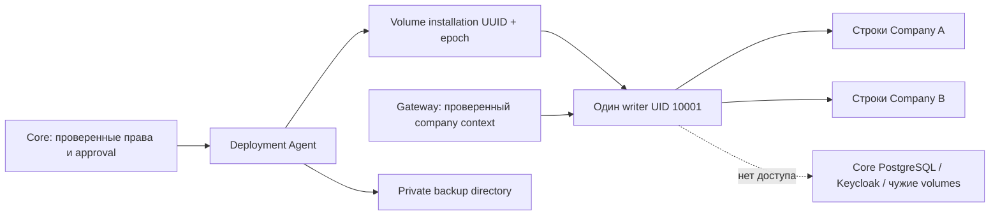

# Безопасность module storage V1

## Граница доверия

Подписанный `module-sdk-v1.json` объявляет SQLite capability и версии схемы.
Deployment approval включает профиль, installation generation, host, SDK hash,
data epoch, allocation revision, лимит 64 МиБ и выбранный backup. Изменение любого
из этих значений требует нового плана и свежего MFA. Старые пакеты не получают
volume автоматически. Gateway не выполняет операции с файлами.

Agent принимает только локальный named volume с точными labels engine/host/
installation/epoch. Driver — `local`, driver options отсутствуют, mount один:
`/data`, `NoCopy=true`. Имя выводится из UUID, не читается из manifest. Проверяются
и HostConfig, и фактические mounts. Bind mounts, symlinks, hardlinks, sparse files,
посторонние tar entries, небезопасные UID/modes и выход за лимиты запрещены.

Stateful runtime сохраняет rootless engine, UID 10001, read-only rootfs, network
`none`, отдельные namespaces, seccomp, no-new-privileges, cap-drop ALL, проверяемые
cgroup limits и exact OCI digest. Дополнительная запись разрешена только в
owned `/data`; `/tmp` остаётся ограниченным tmpfs. SQLite rollback journal находится
рядом с базой, WAL не используется. На базе держится один lifetime writer lock.

Core хранит только metadata и approvals. Agent не получает SQL-доступ Core.
Новые таблицы добавляются миграцией `0013_module_storage`; immutable package/backup
guards и запрет удаления allocations сохраняют историю. Executor получает только
SELECT metadata, необходимой существующему авторизационному predicate.

## Ограничения

SQLite page limit, bounded archive и проверка размера — прикладные ограничения.
Они **не являются kernel disk quota** для произвольного злонамеренного бинарного
модуля. Нужны контроль свободного места host и доверенный publisher. Отдельный
filesystem quota backend потребует нового профиля. Это не HA-хранилище Billing.

Backup хранится в приватном Agent storage root, а не в Core DB или runtime mount.
Метаданные и хэш доступны только Platform Admin с MFA, публичного download нет.
Резервные копии не содержатся в audit. V1 ограничивает каталог восемью backup;
при заполнении операция отказывает, ничего автоматически не удаляет.

Uninstall, quarantine, retirement и deprovision не удаляют volumes. Необратимое
удаление и автоматическая retention cleanup в этом спринте отсутствуют.

