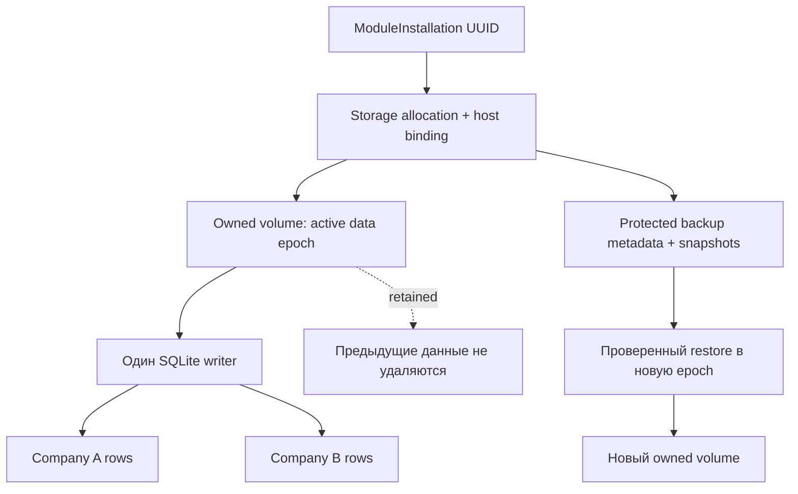

# Постоянное хранилище модуля V1

## Принятая граница

Installation UUID — immutable владелец данных. Stateful capability должна быть
отдельно объявлена подписанным пакетом и утверждена в deployment plan. Старые
offline/private profiles не получают writable storage автоматически.

Выбран named volume без caller-supplied driver options/host paths. Имя и labels
выводятся из проверенных installation/host/data-epoch UUID. Проверяется не только
имя, но и принадлежность engine, host и installation. Runtime получает только
`/data`, оставаясь UID 10001, read-only rootfs, network=none, без capabilities,
Docker socket и Core SQL credentials. Backups в runtime не монтируются.

SDK SQLite находится в фиксированном `/data/storage` 0700, файлы — 0600. Корень
named volume `/data` не содержит business-файлов вне этого каталога. Это позволяет
инициализировать реальные permissions без root helper: Docker игнорирует tar
заголовок корня `.` ([реализация Moby](https://github.com/moby/go-archive/blob/main/archive.go)). Exclusive flock
сохраняется всю жизнь writer. Используются FULL synchronous, rollback journal
в data directory и temp_store=MEMORY. SQL ATTACH, внешние extensions и изменение
journal safeguards запрещены authorizer; statement cache выключен, чтобы ранее
разрешённый internal COMMIT не обходил authorizer во время migration.

SQLite max_page_count резервирует пространство для journal/recovery; проверяется
integrity и суммарный размер файлов. Это application-level контроль размера,
**не kernel quota против произвольного злонамеренного Python-кода**. Отдельный
rootless storage filesystem должен иметь host capacity/quota policy. SDK не
выдаётся за sandbox интерпретатора или HA database.

## Жизненный цикл

| Действие | Данные |
| --- | --- |
| Stop/restart | Сохраняются |
| Совместимый update | Тот же owned volume, один writer |
| Migration | Только после проверенного backup и явного approval |
| Rollback runtime | Проверка совместимости текущей schema до запуска |
| Deprovision | Удаляются только контейнеры, не named volume |
| Uninstall/retire | Бизнес-данные остаются retained |
| Permanent deletion | В Sprint 6B API отсутствует |

Restore должен создавать новую owned data epoch, а не перезаписывать единственный
оригинал на месте. Предыдущая epoch сохраняется. Активная привязка меняется
только после проверки backup и завершения операции. Неудачная migration не
активирует несовместимый runtime; rollback image не означает rollback данных.

Для будущей module-owned PostgreSQL нужна отдельная approved database capability,
собственная identity и network policy. Она не включена в SQLite profile и не
разрешает arbitrary egress или передачу credentials Core.

## Граница будущего PostgreSQL-контракта

Это проект следующей capability, **не активируемая конфигурация V1**:

| Поле | Источник и назначение |
| --- | --- |
| installation_id / generation | Проверенная immutable установка и точная runtime generation |
| database_service_ref | Ссылка на зарегистрированный module-owned DB service; не hostname из manifest |
| database_binding_id | Утверждённая отдельная база и SQL identity этой установки |
| network_policy_id | Отдельно утверждённое ограниченное соединение только к этой базе |
| credential_handle | Ссылка доверенной provisioning boundary на runtime-only credential, без значения секрета в пакете/Web |
| backup_policy_id / schema compatibility | Проверенная политика backup и обновления схемы |

Нужны отдельные approval digest, lifecycle и enforcement tests. В текущем коде
`engine` допускает только `sqlite`; PostgreSQL capability, DB credentials и новые
network settings отвергаются. Core DB, Keycloak DB и SQL migrator identities
никогда не являются допустимым `database_binding_id` модуля.
