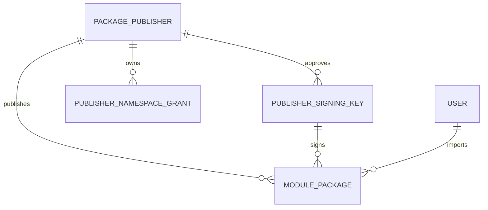
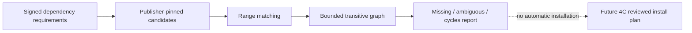

# Verified package registry — не installer

## API

Все маршруты ниже находятся под `/api/v1/platform`, требуют свежий human Platform Admin/MFA:

| Маршрут | Назначение |
|---|---|
| `GET/POST /package-publishers` | bounded listing / регистрация publisher |
| `GET /package-publishers/{uuid}` | метаданные |
| `POST /package-publishers/{uuid}/revoke` | terminal revoke |
| `GET/POST /package-publishers/{uuid}/keys` | bounded listing / добавление public key |
| `POST /package-publishers/{uuid}/keys/{key_uuid}/revoke` | terminal revoke |
| `GET/PUT /package-publishers/{uuid}/namespaces` | authority, не активный permission catalog |
| `GET/POST /packages` | bounded metadata listing / raw ZIP upload |
| `GET /packages/{uuid}` | metadata/current trust/dependency report |
| `GET /packages/{uuid}/manifest` | сохранённый manifest после проверки digest blob |
| `POST /packages/{uuid}/verify` | полная повторная проверка и audit |
| `GET /packages/{uuid}/diff?previous_id={uuid}` | сравнение одной product/publisher lineage |

Lists: limit 1–100, offset 0–100000, stable ordering. Upload — raw body, не multipart,
Content-Type `application/octet-stream` или `application/vnd.xarionix.package+zip`.
201 новый import; 200 exact idempotent retry; 409 same module/version/publisher с другим SHA.
422 invalid package/trust; 413 body limit; 408 upload deadline; 503 заняты 2 slots/недостаточно staging space.
Нет archive download, произвольного server path и удалённого URL import.

## PostgreSQL

Новые revisions `0006_package_registry` и `0007_instance_history` поверх неизменённых 0001–0005. Readiness требует `0007_instance_history`.
Четыре таблицы с UUID/FK/RESTRICT, unique/check/index и identity/revoke/history guards:



ModulePackage содержит module/version/publisher/key, SHA архива/manifest, размер, JSONB manifest,
`available|quarantined`, actor, created/verified timestamps. Storage reference **производится из SHA**,
не хранится как произвольный пользовательский путь. История пакета immutable кроме state/verified_at.
Данные module/company RBAC не переносятся. ModuleInstance terminal revoke теперь защищён и обычным DML;
instance history нельзя стереть DELETE/TRUNCATE, чтобы затем повторно вставить тот же ID как active.

## Storage / транзакционная граница

Private local POSIX filesystem: root `XARIONIX_PACKAGES_STORAGE_ROOT`, default `/var/lib/xarionix/packages`.
В Compose — отдельный named volume, только Core; directory 0700, UID 10001, blobs 0400.
Root и внутренние директории не должны быть symlinks или доступны другим UID.
Не монтируйте это хранилище в исполняющий runtime, web server/static document root или соседний модуль.

```mermaid
sequenceDiagram
  participant A as API
  participant D as PostgreSQL
  participant S as Private CAS
  A->>D: short JWT/human/admin/MFA + trust snapshot
  D-->>A: COMMIT and release lock
  A->>S: bounded staging stream, fsync
  A->>A: threaded strict ZIP/manifest/signature/inventory
  A->>S: rehash copied bytes, fsync, atomic no-overwrite link
  Note over A,S: Crash here leaves an orphan, NOT an available DB package
  A->>D: reverify live JWT/MFA/admin and trust; conflict check
  A->>D: metadata + audit COMMIT
  A-->>A: cleanup staging and release lease
```

Операция использует atomic hard-link publication на **том же локальном filesystem**, а не overwriting rename.
Файлово-DB atomic transaction не существует. Сначала durable immutable blob, затем metadata/audit COMMIT.
При rollback/revoke/version conflict остаётся orphan blob; trusted metadata не остаётся частично сохранённой.
После COMMIT потерянный HTTP response безопасно повторяется: тот же SHA возвращает прежний UUID.
Существующий blob с неправильным digest не перезаписывается. GET manifest и reverify проверяют байты;
corruption/missing/структурная ошибка или несовместимость с ужесточёнными archive limits при reverify
переводит запись в quarantined (`package_reverification_failed` с безопасным reason code).
Это не автоматически означает неверную криптографическую подпись. Восстановление повреждённого referenced blob
выполняет оператор из проверенной резервной копии, затем explicit reverify.

Два POSIX flock slots на весь storage root ограничивают параллельные uploads/reverification даже между workers.
Тот же shared maintenance lease защищает активные staging файлы от reconcile.
При 2 uploads staging+publish занимает не более ~512 MiB; перед staging проверяется свободное место
для 2×128 MiB + 64 MiB. Это не резервирование диска: filesystem quota, запас места и мониторинг обязательны.
Upload deadline 120s (5–300), compressed cap можно только уменьшить; CPU bounded архивными пределами.
Worker thread выполняет hashing/ZIP/crypto вне event loop. Shield + явный join при cancellation
(включая native `Task.cancel()` и повторную отмену) не освобождает lease/файлы до завершения bounded worker.
Неизвестные Content-Length и chunked uploads ограничены фактическим счётчиком. Disconnect/error чистит stage.
Nginx stream route имеет собственный 128m limit, buffering off; остальные API сохраняют 2m reverse-proxy limit.

## Recovery

Оператор с тем же root/volume и DB credentials:

```bash
python -m scripts.package_registry reconcile
# Только после dry-run и резервной копии:
python -m scripts.package_registry reconcile --remove-orphans
```

Exclusive nonblocking maintenance lock берётся **до** DB reference snapshot. При активном upload maintenance
откажет, а не удалит используемый stage. Dry-run считает orphan/stale/missing/corrupt; apply удаляет только
непривязанные digest blobs и stale staging внутри проверенного root; referenced blobs не удаляет.
В apply пишется audit operator event. Если процесс погиб после cleanup, но до audit COMMIT, повторная
сверка безопасна; cleanup не является distributed exactly-once transaction. Нет automatic startup deletion.
Для большого registry maintenance scan выполняется вне HTTP, с filesystem/DB backup и окнами обслуживания.
Local POSIX storage не объявлен поддержкой NFS, object storage или multi-host active-active.

## Verdicts / зависимости

Отдельные признаки: structural/cryptographic validity at verification, current trust, Core compatibility,
dependency metadata resolution и deployment readiness. Listing не хеширует все blobs и честно сообщает
`blob_integrity=not_checked`. Dependency graph report ограничен 256 packages/4096 edges; при превышении
не обещает readiness. Publisher pinned, ranges strict, transitive missing/ambiguity/cycles видимы;
никакого автоматического newest-version выбора. Blob integrity dependencies не проверена этим metadata report.
Diff показывает added/removed/modified permissions, namespaces, artifacts, dependencies, protocol/type/compatibility.


