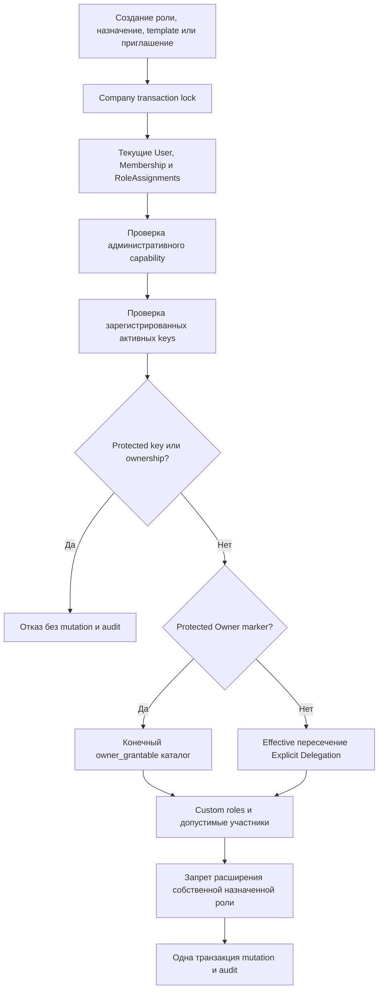

# Делегирование permissions

## Источник полномочий

Управлять ролями может Owner либо участник с явно выданными `core.roles.create/manage/assign/revoke` и необходимым `core.members.roles.assign`. Эти capabilities сами по себе не разрешают выдавать произвольный permission.

Для не-владельца:

`grantable = current effective permissions ∩ explicit permission_delegations`.

Для Owner действует отдельная конечная authority policy: только активные company permissions с `owner_grantable=true`, без protected keys. Это не wildcard; неизвестный/new module permission автоматически не разрешён. Global Platform Admin не участвует в этом выражении.



## Область делегирования

В Sprint 3 политика намеренно не является ABAC-языком. `role_scope=custom_roles`, `member_scope=non_owners` — фиксированные ограниченные scopes. Не-владелец не редактирует protected definitions и не управляет Owner. Переместить scope в другую компанию или изменить его payload нельзя. Более узкие произвольные allowlists отдельных Role/Membership IDs пока не реализованы.

Только Owner может GET/PUT delegation другого active non-owner Membership. Пример PUT `/api/v1/companies/{c}/members/{m}/delegation`:

```json
{"permissions":["core.employees.read","core.employees.manage"]}
```

Это разрешает делегирование только пока эти permissions действительно входят в текущий effective набор получателя policy. Сама policy не выдаёт operation capability. Право менять delegation (`core.permissions.delegate`) protected и не может войти в custom role. Нельзя делегировать делегирование дальше.

Изменение собственного RolePermission набора на расширение запрещено не-владельцу даже при наличии permission из другой роли. Изменение чужой общей роли допустимо только в пределах текущей grantability; поэтому нельзя обойти ограничения косвенным изменением всех её назначений. Permission removal/deactivation немедленно отражается на будущих effective checks.

## Совместимость приглашений

Явное узкое исключение сохраняет Sprint 2: системный Admin может пригласить стандартного Member с базовым набором Member, даже без новой delegation policy. Оно не разрешает custom grants, приглашение Admin или администрирование ролей. Все прочие пути используют ту же `require_grantable`.

`InvitationCreate` дополнительно принимает `role_ids`. Сохраняются company-scoped InvitationRole FK и snapshot полного набора, включая базовую роль. При accept под company lock проверяются active issuer, его current capabilities, current delegation, состояние custom roles и совпадение сохранённого snapshot. Изменившийся permission set требует нового приглашения (`409 invitation_roles_changed`), а revoked authority не становится латентным grant. Custom role нельзя подменить системным Owner/Admin UUID. Повторный accept остаётся одноразовым.

Suspended Membership нельзя обойти re-invite. Восстановление Membership не должно незаметно возвращать более сильные custom grants: при removed они очищаются; при повторной активации не-владельцем заново проверяется grantability существующего набора.

## Конкурентность и аудит

Company lock предшествует чтению authorizing RolePermissions/delegation. Нет process-local authorization mutex или кеша. Если revoke/delegation change COMMIT раньше ожидающего grant, последующий grant увидит новый отказ. Если grant успел COMMIT первым, он был разрешён в своём транзакционном порядке. Ошибка откатывает и links, и audit.

События: `role.created`, `role.updated`, `role.deleted`, `role.permissions_changed`, `role.assigned`, `role.revoked`, `permission.delegation_changed`. Метаданные — IDs/version/count, не JWT, claims, passwords или secrets. Привилегированный прямой SQL не выдаётся company users; scope DB trust boundary и DDL hardening описаны в [security-model.md](security-model.md).
