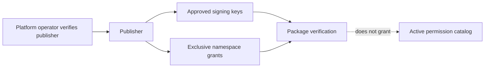

# Доверие к издателям

Trust registry глобальный. HTTP-доступ — только активный human Platform Admin с настроенным свежим MFA.
Company Owner/Admin и dedicated machine token не получают trust operations.
Для production необходимы контролируемая регистрация по fingerprint и независимая сверка public key
с издателем; package manifest не является таким каналом.



Publisher ID и key binding immutable; несколько ключей позволяют ротацию. Unique key ID внутри издателя,
fingerprint нельзя повторно добавить тому же издателю под новым ID, чтобы обойти revoke.
`revoked` terminal для publisher/key/namespace grant; DELETE/TRUNCATE истории запрещены DB guards.
Смена public key требует **новой записи с новым key ID**, а не PATCH старого ключа.

Namespace grant — отдельная authority, не регистрация активных permissions. Namespace уникален глобально,
`core` защищён. PUT задаёт активный набор: убранные grants отзываются навсегда. Не возвращайте их в список
при следующем PUT. Неявной передачи namespace другому издателю нет; такая административная операция требует
отдельно спроектированной maintenance-процедуры. Это консервативное ограничение V1.
Существующие reserved erp/oss/billing namespaces и company RBAC не изменяются.
Если namespace уже есть в Core catalog (active/reserved), его immutable owner должен совпадать
с `module.id`; disabled namespace недоступен. Publisher grant не переписывает владельца существующего продукта.

```mermaid
sequenceDiagram
  participant O as Operator
  participant D as PostgreSQL
  participant R as Registry
  O->>D: revoke key + audit in one transaction
  D-->>O: COMMIT
  R->>D: current publisher/key/grant state
  D-->>R: revoked
  R-->>O: current_trust=false; package/history retained
```

`current_trust` вычисляется при чтении из актуальных publisher/key/grants, не из старого verified flag.
Upload повторяет JWT/MFA/admin и trust после файловой проверки под короткой admin lock.
Reverify читает действующий trust store; revoked key не принимается даже для прежде импортированного пакета.
Исторический `cryptographic_validity_at_import=true` не равен действующему доверию или deployment readiness.
Будущая установка обязана заново проверить blob и live trust непосредственно перед применением.

Offline JSON trust store имеет `schema_version=1` и `keys`, каждая запись:
`publisher_id`, `key_id`, `public_key`, `publisher_status`, `status`, `namespaces`.
Повтор binding запрещён. У файла должны быть защищённый владелец/права и проверенное происхождение:
злоумышленник с возможностью заменить trust store может подсунуть собственный ключ.
Offline verifier не знает о более позднем revoke без обновления operator trust store — это не online PKI.
