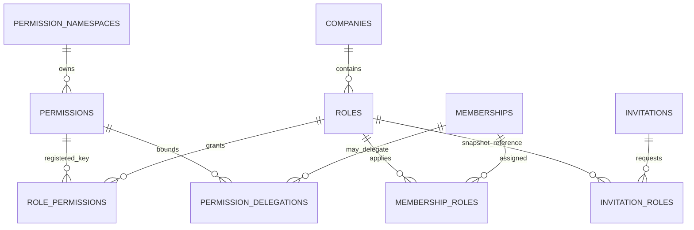
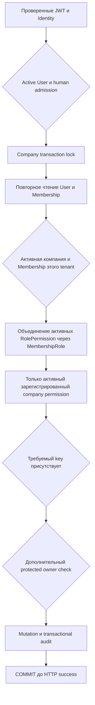

# Permission-based RBAC — Sprint 3

## Модель и источник истины

`app/domains/rbac/authorization.py` вычисляет доступ из PostgreSQL. Keycloak отвечает только за authentication. `iss+sub` определяют Identity, явный admission — human; email, realm roles, произвольные claims и HTTP-заголовки permissions не дают.



Permission key — стабильный внешний идентификатор `namespace.resource.action`, не UUID. Каталог имеет description, scope, active, protected, owner_grantable; namespace — проверенного владельца и lifecycle. Нет wildcard, наследования ролей, deny-языка, внешнего authorization cache или ABAC runtime.

Role UUID, code, company_id, name, description, active, is_system, version, definition_version и timestamps хранятся отдельно. Код уникален в компании и не меняется после создания. Company/Membership/Role composite FK не позволяют назначить чужую роль. Повторные назначения и permission links запрещены PK. Поля company_id/is_system/creator не принимаются из mutable HTTP payload.

## Совместимость и владение

`Membership.role` сохраняется как защищённый совместимый owner/admin/member marker. Системное назначение с `origin=system` **выводится из него PostgreSQL-триггером**, а не поддерживается вторым независимым Python-путём. Это обеспечивает совместимость старого PATCH Membership, ownership transfer и direct DML. Обычное API назначения добавляет только custom roles с `origin=custom`; системный Admin/Member меняется прежним owner-controlled Membership PATCH, ownership — явной защищённой операцией. Попытка назначить system role новым endpoint даёт 403.

Owner — бизнес-инвариант, а не пользовательский code/name. Обычный custom grant не делает владельцем. Последний usable owner защищён targeted deferred PostgreSQL guard, включая приостановку User и конкурентный direct DML. Removed Membership теряет custom assignments; повторное приглашение не восстанавливает скрытые прежние grants. Suspended Membership не получает effective permissions.

Owner/Admin/Member имеют явные версионированные наборы `catalog_v1.py`, установленные миграцией. V1 — immutable deployment manifest: будущие изменения оформляются новой версией и Alembic revision, не редактированием установленного V1. Определения system roles, их links и compatibility assignments защищены от обычного DML. Изменение системной модели доверенным deployment должно включать `system_role.updated` audit. Новые permissions не попадают в эти наборы автоматически.



На чтение берётся shared company advisory lock, на mutation — exclusive. Проверка после получения lock не использует старый permission snapshot. Один bulk join вычисляет permissions всех ролей без N+1. Привилегия Platform Admin не является fallback для company access.

## Матрица защищённых полномочий

| Полномочие | Кто управляет | Custom role/delegation |
|---|---|---|
| Ownership | Только действующий Owner через старый business API | Нельзя |
| `core.ownership.transfer` | Owner marker + системный permission | Нельзя |
| `core.company.manage` | Owner marker + системный permission | Нельзя |
| `core.permissions.delegate` | Owner marker + системный permission | Нельзя |
| Системные role definitions/templates/catalog | Только доверенный versioned deployment | Нельзя менять company API |
| Platform Admin | Отдельная global grant + human + свежий MFA | Не company permission |
| Остальные доступные company permissions | Owner authority либо effective ∩ delegation | В разрешённой области |
| ERP/OSS/Billing | Namespace пока reserved, permissions не зарегистрированы | Ничего не выдаётся автоматически |

## API

Все пути начинаются с `/api/v1`, требуют JWT и human admission. Company routes дополнительно проверяют tenant и permission. Pagination: `items,total,limit,offset`, limit 1–100, offset 0–100000.

| Операция | Требование |
|---|---|
| GET `/permissions`, `/role-templates` | Active human, только доступный каталог |
| GET `/companies/{c}/roles`, `/{r}`, `/{r}/permissions` | `core.roles.read` |
| POST `/companies/{c}/roles` | `core.roles.create` + grantability |
| PATCH `/companies/{c}/roles/{r}` | `core.roles.manage` + grantability текущего набора |
| PUT `/companies/{c}/roles/{r}/permissions` | `core.roles.manage`, grantability и self-expansion guard |
| DELETE `/companies/{c}/roles/{r}` | `core.roles.manage`; нет assignments/references |
| GET `/companies/{c}/members/{m}/roles` | `core.roles.read` |
| POST `/companies/{c}/members/{m}/roles` | `core.roles.assign` + `core.members.roles.assign` + grantability |
| DELETE `/companies/{c}/members/{m}/roles/{r}` | `core.roles.revoke` + `core.members.roles.assign` + grantability |
| GET/PUT `/companies/{c}/members/{m}/delegation` | Protected `core.permissions.delegate`, Owner |
| GET `/companies/{c}/me/permissions` | Собственный active Membership |

PATCH metadata и PUT permissions требуют `expected_version`. Конкурентный устаревший запрос — 409 `role_version_conflict`; успешный ответ содержит новую version. DELETE assigned role — 409; можно сначала снять назначения либо выключить custom role через `active=false`. Отключение не удаляет связи/аудит, но немедленно убирает её effective permissions. Role с сохранёнными InvitationRole links нельзя удалить до отдельного lifecycle решения; используйте deactivation.

Создание собственной роли:

```json
{"code":"network_engineer","name":"Сетевой инженер","permissions":["core.employees.read","core.employees.manage"]}
```

Создание независимой копии template:

```json
{"code":"shift_manager","name":"Сменный руководитель","template_key":"core.template.company_manager","template_version":1}
```

Одновременно передавать непустой permissions и template нельзя. Snapshot не меняется вслед за будущим шаблоном. Grantability проверяется и для template.

Назначение: POST `/companies/{company_uuid}/members/{membership_uuid}/roles`, body `{"role_id":"<role_uuid>"}`. Ответ — 204. GET `/companies/{company_uuid}/me/permissions` возвращает company_id, membership_id, protected owner boolean и отсортированные keys. Отзыв действует в следующем проверяемом запросе, без рестарта/TTL.

Коды ошибок: 401 JWT; 403 недостаточные права/protected action; 404 чужой tenant/resource; 409 конфликт lifecycle/version/constraints/transaction; 422 malformed, неизвестный либо недоступный permission. В ответ не попадают SQL, input secret и stack trace.

## Ограничения

200 ролей на компанию, 50 назначений на Membership, до 100 keys в запросе; для приглашения до 20 custom roles. Нет role hierarchy и permission wildcard. Owner authority ограничена каталогом `owner_grantable`, а не всеми будущими permissions. Настоящие права модулей появятся только после доверенного deployment/registration.
