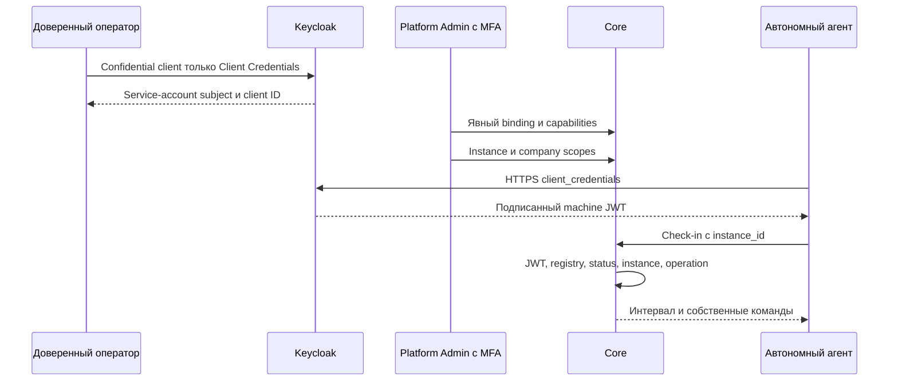

# Service authentication и регистрация

## Проверяемый контракт

Managed/external используют прежний настроенный trusted issuer и OIDC/JWKS verifier. Проверяются signature, alg/kid allowlist, iss, exp/iat/nbf, `typ=Bearer`, sub и отдельная audience `XARIONIX_MODULES_AUDIENCE` (default `xarionix-core-modules`). Human audience остаётся `xarionix-core`.

Дополнительно обязательны подписанный `xarionix_principal="machine"` и bounded `azp`. Binding — точное `(iss,sub,azp)`; если JWT также содержит `client_id`, он обязан совпадать с azp. Service-account sub UUID **не** заменяется client identifier. Username/email/realm roles и client_id из body не дают полномочий.

Реальные tests на закреплённом Keycloak 26.8.1 проверяют отдельные sub/azp, signature/audience/expiry. Используются native sub mapper, отдельный audience mapper и purpose claim; human ACR/auth_time test mappers для машин не применяются.



## Подготовка Keycloak

1. Отдельный confidential OIDC client на установку. Включить service accounts/client authentication; выключить standard/implicit/direct grants и произвольные redirects. Human login flow для него не используется.
2. Audience mapper: custom audience `xarionix-core-modules` либо явно настроенное значение; не добавлять human Core audience. Access JWT должен содержать native sub и azp.
3. Hardcoded access-token claim `xarionix_principal=machine`, type String. Не переносить test ACR/auth_time mappers. Purpose marker **не** permission: без registry binding он не даёт доступ.
4. Не назначать realm-management/Core admin роли. Получить service-account subject доверенным операторским способом и проверить настоящий JWT; не регистрировать непроверенный payload пользователя.
5. Передать client secret только через закрытую deployment config/secret store. Core не хранит этот secret и не требует IdP master-admin credentials. External realm Core не изменяет.

Endpoints/flow: [официальная документация Keycloak](https://www.keycloak.org/securing-apps/oidc-layers#_client_credentials). Production provisioning service clients не автоматизирован: installer не создаёт новые grants.

## Регистрация

POST `/api/v1/platform/module-services` требует настоящего Platform Admin JWT и свежего настроенного MFA:

```json
{
  "module_key": "test-autonomous-module",
  "name": "Тестовый модуль",
  "issuer": "https://auth.example.org/realms/xarionix",
  "subject": "service-account-subject-from-idp",
  "client_id": "isolated-module-installation",
  "operations": ["core.modules.connect", "core.modules.heartbeat", "core.modules.commands.read", "core.modules.commands.ack", "core.modules.metadata.read"]
}
```

Затем POST `.../module-services/{id}/instances` с `{"installation_key":"installation-one"}`. Scope: PUT `.../module-instances/{i}/companies/{c}` с `{"status":"active","operations":["core.modules.metadata.read"]}`. User/Membership не создаются; module_key не активирует namespace.

Binding immutable; конфликт issuer+subject или issuer+client_id — 409. Legacy Identity не перепривязывается автоматически. Смена subject/client identity требует новой явной регистрации/нового client; ротация client secret/JWKS при стабильном binding не требует нового instance.

Disable обратим через enable, revoke terminal. После COMMIT отзыва следующий запрос запрещён даже при валидном JWT. Можно отдельно отозвать scope. Операция, уже удерживающая service share lock, может завершиться **до** COMMIT revoke; ожидающая после него видит отказ.

Machine purpose/audience запрещены на human API до JIT, включая `/me` и `/system/info`. Registry subject также защищён от legacy Identity insertion resolver/DB trigger. Старый human-audience unclassified JIT сохранён для совместимости; это не service registration/human admission и не путь нового агента.

При утечке секрета: revoke в Core и rotate/revoke в Keycloak. Не публикуйте tokens, `.env`, docker inspect/config и client secrets в CI artifacts. Docker operator всё равно имеет доступ к container environment; это не vault.
