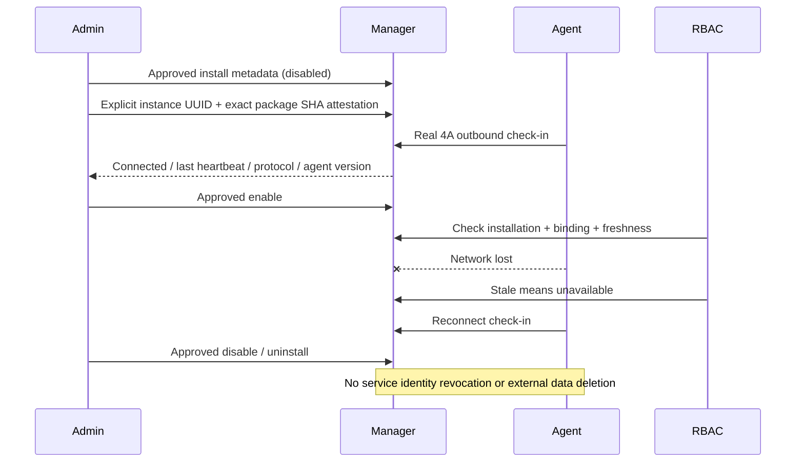

# Sprint 4C — проверка и ограничения

Рабочее дерево основано на e1eea1a; старые миграции, Runner и соседние репозитории не меняются.
Проверки выполняются локально с Docker Desktop, в отдельных randomly named Compose projects.
GitLab pipeline для этих незакоммиченных изменений не запускался. Production deployment,
commit/push, изменение Runner и credentials существующего окружения не выполнялись.

## Реализовано

Установка глобальная, один текущий package на module_id. Шесть новых таблиц:
`module_installations`, `module_dependency_pins`, `module_install_plans`,
`module_install_operations`, `module_installation_history`, `module_instance_bindings`.
Approval хранится вместе с immutable планом; JWT в jobs отсутствует. Все новые references —
UUID/FK RESTRICT, generation/version и namespace/publisher continuity проверяются при apply.
Partial UNIQUE index допускает только одну applying operation на module_id.

Новые миграции: `0008_module_installations` (таблицы/guards/catalog capability/epochs),
`0009_catalog_read_checks` (SELECT-only RBAC epoch check), `0010_instance_enrollment`
(монотонная provenance ранее привязанного агента). 0001–0007 не изменены. Readiness требует 0010.
Dev обновлён обычным additive upgrade; DB volumes и Keycloak не пересозданы.

Цикл: install → disabled → enable; update/rollback возвращают disabled и требуют отдельного
enable. Uninstall — из disabled, сохраняет историю/данные/машинные identities. Все операции
используют saved plan + exact digest + MFA approval + отдельный trusted CLI. Runtime не
получает catalog DML/EXECUTE installer function или migration credentials.

## Обнаруженные и исправленные дефекты

- SELECT FOR SHARE внутри epoch trigger требовал UPDATE на permissions у restricted runtime.
  Это выявил настоящий owner/migrator/runtime rehearsal, а не mock. 0009 заменяет его на
  SELECT; конкурентная смена epoch fail-closed исключает старый grant из effective authorization.
- Демо-агент имеет retry backoff до 60 секунд; прежнее окно reconnect 45 секунд было меньше
  штатного интервала. Integration теперь ждёт readiness polling до 150 секунд, не меняя агент
  и не подменяя его heartbeat. Ошибка API в polling выводит HTTP status и безопасный code.
- Unbind/replacement мог вернуть ранее enrolled instance в legacy 4A fallback. 0010 фиксирует
  `installation_managed` необратимо: старый instance требует актуальный binding/availability,
  но по-прежнему может делать heartbeat/ACK. Отдельный реальный API/DB regression это проверяет.
- Установка definitions не должна возвращать старые назначения после reinstall/rollback:
  добавлены монотонные epochs definitions/RolePermissions/Delegations, backend availability gate.
- Список установок не должен повторять SQL для каждого binding/package. Для страницы —
  bulk loading с постоянным числом запросов; unit regression сравнивает страницы 1 и 100 записей.
- Проверка отсутствующих моделей в локальном `make test` зависела от старого shebang pytest
  после смены Python venv. Make использует `.venv/bin/python -m pytest`, тот же interpreter,
  которым установлены зависимости. CI gates/порог покрытия не ослаблены.
- Негативный тест первоначально ошибочно ожидал повторный grant отозванного namespace.
  Проверка исправлена на 409: терминальная revocation Sprint 4B не ослаблена ради теста.

## Фактически выполненные проверки

| Проверка | Результат |
|---|---|
| Unit/API, `make check` | 523 passed; coverage 73,53%, обязательный порог 70% сохранён |
| Новый lifecycle + migration rehearsal (отдельный запуск) | 16 passed |
| Outbound Docker agent + RBAC/dependency integration (отдельный запуск) | 3 passed |
| Unbind/rebind regression, head 0010 | 1 passed |
| Полный integration suite, финальный head 0010 | **106 passed**, без failures/skips, 589,23 секунды |
| Ruff / Ruff Format | Passed |
| MyPy | Passed, 97 source files |
| Bandit | Passed, без подавления новых findings |
| pip-audit runtime/dev lockfiles | Passed, известных уязвимостей не найдено |
| Compose dev/external/managed | Passed, interpolation/mounts/privileges/dependencies |
| Nginx test с временными сертификатами | Passed (`scripts.compose_check --nginx`) |
| Production multi-stage Docker build / image-check | Passed: non-root, read-only, live 200, unready 503, no token 401 |
| Trivy HIGH/CRITICAL | Passed, gate остаётся blocking |
| Gitleaks Git history + non-ignored working tree | Passed, redacted reports |
| `make dev-up`, `make dev-test` | Passed: healthy DB/Keycloak/Core, live/ready, 401, discovery/JWKS |
| GitLab pipeline / production deployment | Не запускались |

Первый полный прогон выявил 3 отказа (102 passed); после исправлений тесты перепроверены.
Следующий прогон был намеренно остановлен после 59 passed для включения security-fix enrollment;
он не считается полным успешным прогоном. Финальный неизменяемый прогон прошёл целиком:
**106 integration + 523 unit/API tests**, 73,53% unit coverage. Финальные JUnit/coverage reports: `reports/integration.xml`,
`reports/unit.xml`, `reports/coverage.xml`; отчёты не содержат `.env`/JWT/client secrets.

Тесты используют реальные PostgreSQL 18, Keycloak и отдельные restricted SQL credentials.
Операторские тесты повторно проверяют реальные подписанные bytes в private temporary CAS
тем же verifier/storage 4B; API upload/plan использует настоящий CAS контейнера, SHA совпадают.
Нет mock замены PostgreSQL в проверках транзакций/привилегий. Fixture генерирует временные
Ed25519 keys и inert resources-only версии 1.0.0/1.1.0 с permission diff; ключи не являются
production trust anchors и не коммитятся.

Проверены rollback до/после catalog DML и до COMMIT, потеря ответа после COMMIT, повторный
apply, два плана/исполнителя, lease/fence recovery, expiry, corrupt CAS, publisher/key/grant
revocation до и во время apply, digest mismatch, MFA/RBAC denial, dependencies, exact pins,
namespace/catalog protections, запрет DML/DDL/SET ROLE, реальное отключение сети агента.
Upgrade rehearsal 0007 → head сохраняет Identity/User/Company/Membership, Employee/Invitation,
RolePermissions, ModuleService/Instance, Publisher/Key/Grant/Package и Audit UUID/данные.

## Изменённые файлы

Код: `app/domains/installations/{__init__,model,policy,service,executor}.py`,
`app/api/v1/{installation_schemas,installations,rbac}.py`,
`app/core/{access,database}.py`, `app/domains/modules/{model,authorization}.py`,
`app/domains/packages/service.py`, `app/domains/rbac/{model,authorization,service}.py`,
`app/domains/registry.py`, `app/main.py`, `scripts/module_manager.py`,
`deploy/postgres/module-executor.sql`, `migrations/versions/0008_module_installations.py`,
`0009_catalog_read_checks.py`, `0010_instance_enrollment.py`, `Makefile`.

Тесты: `tests/test_installations.py`, `tests/test_module_manager_cli.py`, `tests/test_rbac.py`,
`tests/integration/test_module_installations.py`, `test_installation_agents.py`,
`test_managed_stack.py`, `test_module_db_privileges.py`, `test_module_control.py`.

Документация: README и восемь новых документов module-manager/lifecycle/security/executor/
dependencies/permission-activation/recovery/validation; обновлены architecture, security-model,
module-permission-contract, package-registry, module-communication, runtime-database-roles.
Восемь Mermaid diagrams описывают фактические границы, а не ещё не реализованный runtime.

## Известные границы

- Legacy dev `core_app` остаётся table owner и имеет DDL-риск. Production требует отдельного
  owner/migrator/runtime и явного DBA provisioning restricted installer. Credentials автоматически
  не меняются; `module-executor.sql` не запускается из Core/install.sh/Alembic.
- Standard backend/frontend runtime и migrations из пакета не выполняются. Metadata-only
  режим не выдаётся за запущенный сервис; autonomous binding — administrative attestation,
  а не криптографическое доказательство версии бинарника.
- Required dependency нельзя обновить/удалить с installed dependents: coordinated rollout
  отложен, автоматического repin нет. Resolver ограничен 256 candidates / 32 transitive pins.
- Namespace/publisher revoke терминален; ordinary apply требует current trust даже для
  uninstall. Такая запись остаётся недоступной с историей до отдельного maintenance решения;
  unsafe bypass не добавлен. Отзыв одного signing key допускает trusted update новым ключом,
  если publisher/namespace authority по-прежнему действуют.
- Reconcile read-only; external execution, удаление business data и distributed exactly-once
  не обещаются. Локальные тесты не являются production throughput SLA.

## Autonomous binding



Binding — явная административная attestation соответствия external runtime конкретному
package SHA, а не криптографическое измерение agent binary. Протокол 4A проверяет JWT/service
identity и heartbeat; runtime attestation/remote provisioning принадлежат отдельному 4D.

## Запуск

```sh
make check
make integration-test
make dev-up
make dev-test
make docker-build
make docker-scan
```

Не запускать install.sh поверх существующего dev, не удалять его volumes/credentials.
DB role provisioning выполняется **только** в disposable integration DB; существующий dev
после additive migration не получает installer capability автоматически.

## Отложено на 4D

Отдельный Deployment Agent с allowlisted declarative actions и минимальными deployment
credentials. Core создаёт desired revision/job; агент инициирует outbound канал, выполняет
идемпотентные шаги в изолированном runtime namespace, публикует наблюдаемый результат.
Standard modules — отдельные ограниченные containers/services, не import в Core process.
Нужны digest-pinned images, resource/network/filesystem limits, signed artifact attestation,
secret references, проверяемая rollback strategy и scoped migration authority. Core не получает
Docker Socket или произвольный shell API. Autonomous runtime остаётся внешним с explicit binding.
Будущая Angular integration использует versioned declarative frontend contract/CSP и отдельную
trust review; не исполняет JS из `.xpkg` внутри административной страницы в 4C.
