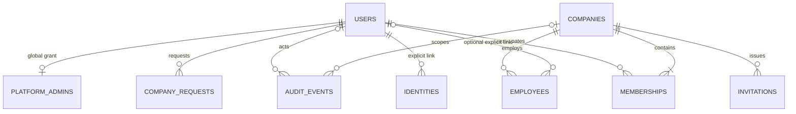
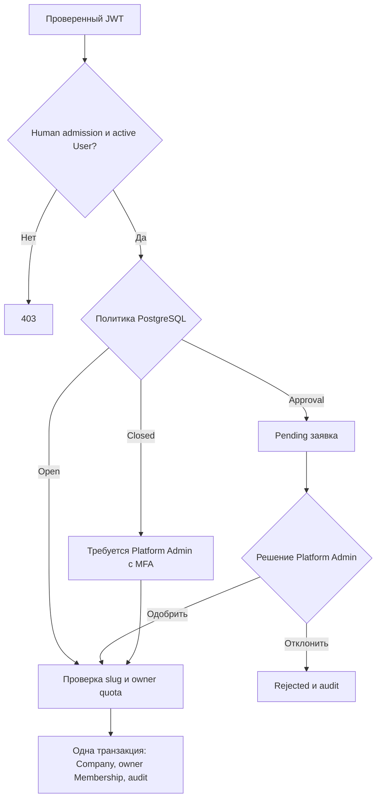

# Пользователи, компании и участие — Sprint 2

## Разные сущности

- **Identity** — проверенный внешний `(issuer, subject)`, стабильный внутренний UUID и явный principal type.
- **User** — глобальный профиль UUID, display_name, active/suspended. Не пароль и не credential.
- **Membership** — одна lifecycle-запись `(company_id, user_id)`, роль owner/admin/member, active/suspended/removed. User может состоять в нескольких компаниях.
- **Employee** — company-scoped рабочая запись: имя, должность, отдел, active/inactive; User необязателен. Явный user link требует активного Membership той же компании. Уникальность `(company_id,user_id)` не ограничивает несколько сотрудников без User.

Все UUID назначаются сервером. Email не идентификатор и не механизм объединения Identity/User. Автоматического linking API нет. При удалении связанных сущностей FK использует RESTRICT; destructive DELETE компаний/пользователей не добавлен. Компания архивируется, Membership переводится в removed.

## Создание компании

| Политика | Human user | Platform Admin с MFA |
|---|---|---|
| closed | Создание и заявки запрещены | Прямое создание |
| approval (default) | Только заявка | Одобрение/отклонение или прямое создание |
| open | Прямое создание | Прямое создание |

Глобальные настройки — singleton PostgreSQL, создаются идемпотентно миграцией. `max_owned_companies_per_user=3`, `invitations_enabled=true`. Лимит считает owner-записи active/suspended в неархивных компаниях; обычное участие не ограничивается. Уникальный slug не зависит от имени. Нормализация: trim + lowercase, ASCII `[a-z][a-z0-9-]{1,61}[a-z0-9]`, без двойных дефисов и reserved names. Переименование не меняет UUID.

Pending-заявка не резервирует slug и не создаёт компанию. При одобрении заново проверяются active human заявитель, лимит, slug и статус заявки. Одобрение уже отправленной заявки допускается даже после смены политики на closed — это явное административное решение. Повтор/конкурентное одобрение даёт 409 без дублей. Собственную pending-заявку можно отменить; чужая выглядит как 404.

## Роли и владение

| Действие | member | admin | owner |
|---|---|---|---|
| Читать компанию/участников/сотрудников | Да | Да | Да |
| Изменять сотрудников | Нет | Да | Да |
| Пригласить member | Нет | Да | Да |
| Пригласить admin | Нет | Нет | Да |
| Управлять member | Нет | Да | Да |
| Управлять admin/owner | Нет | Нет | Да |
| Переименовать/архивировать/восстановить компанию | Нет | Нет | Да |
| Передать владение | Нет | Нет | Да |
| Глобальные политики | Нет | Нет | Нет — нужна отдельная Platform Admin grant |

Owner может явно назначить совладельца через Membership PATCH; при этом проверяется quota нового владельца. Owner invitation запрещена. `transfer-ownership` делает выбранного активного human-участника owner, текущего owner — admin, атомарно. Другие совладельцы не меняются. Последний активный owner защищён от выхода, исключения, demotion и suspension; PostgreSQL deferred check также учитывает active User. Приостановка Membership не удаляет Employee и не меняет User в других компаниях.

Неактивная компания блокирует обычные domain actions. Явный active owner может управлять её метаданными/восстановлением; при восстановлении архивной компании проверяется quota, а на COMMIT — наличие owner. Критические операции сериализованы DB gate, а не предварительной проверкой в Python без lock.

## Приглашения

Секрет — `secrets.token_urlsafe(32)` (256 бит), в DB только SHA-256. Он возвращается только при POST создания; list/revoke/audit не содержат secret/hash. TTL 1–168 часов, по умолчанию 72. Recipient UUID и normalized email необязательны; если указаны оба, проверяются оба. Email требует exact `email_verified is True` из проверенного JWT. Он не объединяет пользователей.

Accept: `POST /api/v1/invitations/accept`, JSON `company_id` + `secret`; токен не помещается в URL. Проверяются pending/expiry, recipient, active company, действующие права издателя и отсутствие существующего active/suspended Membership. Removed Membership можно восстановить только новым приглашением; suspended не обходится re-invite. Membership и статус accepted сохраняются одной транзакцией, повторное/конкурентное использование даёт 409. Роль определяется сохранённым приглашением, не accept payload. Выдача/accept отключаются глобальным `invitations_enabled`; чтение/отзыв остаются доступны.

## HTTP API

Все URI ниже начинаются с `/api/v1`; списки имеют `items,total,limit,offset`, limit 1–100, offset 0–100000, стабильный tie-break UUID.

| Метод и URI | Назначение |
|---|---|
| GET `/me` | Совместимые id/issuer/subject + user_id, principal_type, профиль и timestamps |
| PATCH `/me` | Только display_name (можно null); human admission обязателен |
| GET `/me/companies`, GET `/companies` | Только свои active Membership, включая статус компании |
| POST `/companies` | Создать компанию и первый owner по политике |
| GET/PATCH `/companies/{company}` | Просмотр / owner metadata lifecycle |
| POST `/company-requests`, GET `/company-requests/me` | Создать / свои заявки |
| POST `/company-requests/{request}/cancel` | Отменить собственную pending |
| GET `/companies/{company}/members` | Участники |
| PATCH/DELETE `/companies/{company}/members/{member}` | Разрешённая role/status mutation / removed |
| POST `/companies/{company}/leave` | Собственный выход |
| POST `/companies/{company}/transfer-ownership` | target_membership_id, атомарная передача |
| GET/POST `/companies/{company}/employees` | Список / создание |
| GET/PATCH `/companies/{company}/employees/{employee}` | Scoped detail / изменение |
| GET/POST `/companies/{company}/invitations` | Список / выдача secret один раз |
| DELETE `/companies/{company}/invitations/{invitation}` | Отзыв pending |
| POST `/invitations/accept` | Атомарное принятие |

Platform endpoints описаны отдельно в [platform-administration.md](platform-administration.md). Все request DTO запрещают extra fields, PATCH принимает только явные поля. Actor/created_by/reviewed_by определяются сервером. Нет password/Identity creation endpoint. 401 — JWT, 403 — permission/state/MFA, 404 — недоступный scope/UUID, 409 — lifecycle/DB conflict, 422 — невалидное тело/пагинация. Непредвиденные ошибки — нейтральный 500; input/SQL/секреты не отражаются.

## Миграция и проверка

Сделайте backup, используйте текущие credentials/volumes и `alembic upgrade head` через штатный `migrate` service. Для production нужен maintenance rollout: остановите старый Core/входящий трафик, соберите новый image, выполните миграцию и запустите новый Core. Старый resolver не заполняет новый обязательный user_id; zero-downtime совместимость старой версии с новой схемой не заявляется. DB/Keycloak volumes не удаляются. `create_all`, drop_all и автоматический downgrade не используются. Legacy backfill протестирован на реальной `0001_identity` с существующей записью; её id и issuer/subject сохраняются. Readiness требует `0002_platform`. Для dev повторите `make dev-up`; существующий realm не перезаписывается импортом.

Локально: `make check`, `make integration-test`, `make dev-up`, `make dev-test`, `make docker-build IMAGE=xarionix-core:sprint-2`, `make docker-scan IMAGE=xarionix-core:sprint-2`. Integration использует отдельные test volumes и реальный Keycloak/PostgreSQL. Результаты — [sprint-2-validation.md](sprint-2-validation.md).
