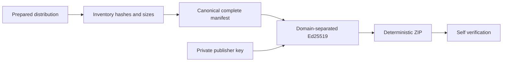
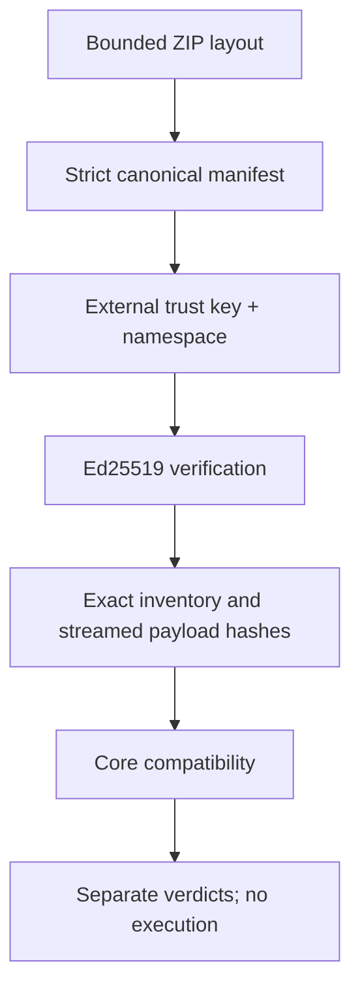

# Подписи `.xpkg`

Ed25519 из [cryptography](https://cryptography.io/en/latest/hazmat/primitives/asymmetric/ed25519/),
не собственная криптография. SHA-256 — digest, не механизм доказательства происхождения.
Доверенный публичный ключ поступает **из operator trust store/Core**, не из архива.

Envelope `signatures/publisher.json` содержит только:
`schema_version=1`, `algorithm=Ed25519`, `publisher_id`, `key_id`, `signature`.
Signature — strict canonical base64 ровно 64 байт; public key — base64 ровно 32 байта.
Fingerprint — lowercase SHA-256 сырых public-key bytes.

Подписываемое сообщение:

```text
ASCII("XARIONIX-XPKG") || 00 || ASCII("SIGNATURE") || 00 || ASCII("V1") || 00
|| XPKG-CJSON-1({
  "schema_version": 1, "algorithm": "Ed25519",
  "publisher_id": <publisher>, "key_id": <key-id>, "manifest": <complete manifest object>
})
```

Envelope identity/algorithm тоже связаны подписью; поле signature не подписывает само себя.
Manifest содержит все artifact names/digests/sizes, compatibility, permissions, dependencies и module metadata.
Подмена любого из них ломает проверку; extra/missing payload запрещены независимо от подписи.





`keygen` использует CSPRNG, PKCS8 PEM private file 0600 и O_EXCL. Не перезаписывает файлы.
V1 CLI принимает **только нешифрованный** private key с закрытыми Unix permissions; хранить его следует
в отдельной защищённой/offline среде. Passphrase/hardware signing providers пока не реализованы.
Ни API, ни Core container не получают publisher private keys. Не сохраняйте их в payload, Git,
build context, CI variables/artifacts или контейнерах приложения. Команды печатают только public key/fingerprint
и JSON verification report; crypto/parser ошибки возвращают bounded codes без дампа входа.

Тестовый RFC8032 seed/вектор не регистрируется автоматически. Утечка настоящего ключа требует отзыва,
нового ключа и расследования уже импортированных пакетов. Подпись от доверенного, но скомпрометированного
издателя не доказывает отсутствие вредоносного кода. Лицензий, DRM, аппаратной привязки и активации нет.
