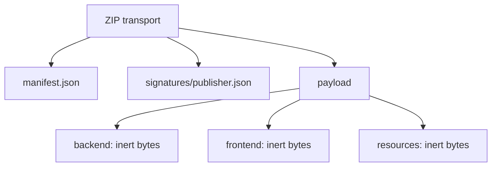

# `.xpkg` V1 — нормативный формат

6A определяет [module-api-v1.json](module-api-contract.md) как дополнительный signed
inventory resource, не новый manifest/signature format. Старые canonical test vectors
и artifact limits остаются прежними. Без этого resource legacy package не получает API.

4D определяет [bounded OCI runtime profile V1](module-runtime-artifacts.md) внутри прежних
artifact roles/подписанного inventory. Manifest/signature format и лимиты V1 не изменены.
Valid inert XPKG не обязательно является допустимым runtime: OCI проверяется дополнительно,
а запуск требует separate approved deployment. Произвольных flags/URLs в contract нет.

Пакет — инертная подписанная дистрибуция, **не установка и не разрешение выполнять код**.
Core product version берётся из wheel/editable metadata `pyproject.toml` через `app.version.VERSION`;
API/OpenAPI и build tooling используют ту же версию. Номер продукта не повышен: 0.1.0.

## Контейнер

Один однодисковый ZIP с файлами:

Только ZIP STORED (0) или raw DEFLATE (8), версия распаковки ≤20, flags 0/UTF-8.
Запрещены ZIP64, шифрование, data descriptors, дополнительные поля, комментарии, SFX-префикс,
хвост после EOCD, дополнительные диски, дырки/перекрытия, каталоги-записи, ссылки/devices/FIFO.
Local headers, имена, CRC и размеры должны совпадать с central directory. Весь compressed stream
должен принадлежать ровно одной записи: лишний хвост DEFLATE запрещён.
Никакого extract/extractall. Вложенные архивы — только обычные инертные байты; рекурсивного unpack нет.

Имена — ASCII POSIX, `[A-Za-z0-9_./-]+`, ≤240 байт, ≤12 компонентов. Нет пустых компонентов,
`.`/`..`, ведущей/завершающей точки в компоненте, backslash, drive, NUL, reserved Windows device names.
Это сознательно более узкий переносимый контракт, чем произвольные ZIP/Unicode filenames.
Дубли, включая различие только регистром, запрещены. Unicode paths отвергаются, а не нормализуются.
Иконки/локализованный текст внутри файлов не ограничены этим правилом имени.

## Manifest

Строгая Pydantic-схема: неизвестные поля запрещены, типы не приводятся, Boolean не является integer version.
Обязательные поля:

| Поле | Контракт |
|---|---|
| `schema_version` | ровно integer 1 |
| `module` | `id`, `name`, `version`, `type`; необязательные `description`, `homepage` |
| `publisher` | только `id` |
| `compatibility` | `core` range, `module_protocol` ровно integer 1 |
| `permissions` | один `namespace`, список `definitions` с `key`, `description`, `scope=company` |
| `dependencies` | список `module_id`, **`publisher_id`**, `version` range |
| `artifacts` | исчерпывающий список `path`, integer `size`, lowercase SHA-256 |

ID: lowercase `[a-z][a-z0-9-]{1,62}`. `core`/`xarionix-core` как module ID запрещены.
Namespace: `[a-z][a-z0-9_]{1,39}`, не `core`; все permission keys принадлежат этому namespace.
Отсутствие permissions допустимо как `definitions=[]`, но namespace authority всё равно требуется.
Нет grant/protected flags: пакет не может изменить защищённые Core permissions.
Dependencies — максимум 64, без дублей module ID и self dependency. Publisher pin обязателен:
одинаковый module ID другого издателя не считается заменой зависимости.
Artifacts — от 1 до 1022 уникальных файлов, только под `payload/backend/`, `payload/frontend/`,
`payload/resources/`. Нет неуказанных файлов. `manifest.json` и envelope — единственные служебные записи.
Версии/имена/описания ограничены в схеме. Homepage — строка до 512 символов, **никогда не URL запроса**.
Очевидные `.env`, `.pem`, `.key`, `.p12`, `.pfx`, `id_rsa`, `id_ed25519`, credentials/secrets filenames
запрещены; это preflight, не обещание обнаружить секрет внутри произвольного binary.
Готовый пример — `examples/xpkg/manifest.json`.

## Канонизация XPKG-CJSON-1

Это **не заявление совместимости с RFC8785**. Алгоритм V1:

1. UTF-8 без BOM; strict JSON; повторяющиеся object keys запрещены на любой глубине.
2. Только object/array/string/integer/boolean/null. Нет float, NaN, Infinity; integer ≤2^53−1 по модулю.
3. Глубина ≤16, array ≤2048, object ≤1024, string ≤4096 Unicode scalar characters.
4. Строки обязаны уже быть NFC; surrogate code points и C0 controls запрещены. Ничего не исправлять молча.
5. Сортировать object keys по Unicode code point; без пробелов; `,`/`:` separators; non-ASCII прямо UTF-8.
6. JSON escaping кавычки/backslash стандартный. Объект manifest подписывается **целиком**, без подстановки defaults.
7. Сохранённый `manifest.json` обязан точно равняться canonical bytes. Порядок массивов значим.

`canonical({"z":2,"a":"Тест"})` → UTF-8 `{"a":"Тест","z":2}`.
Фиксированный полный вектор: `tests/fixtures/xpkg-v1-vector.json` (canonical bytes, digests, key, signature).
Указанный там RFC8032 seed публичный и предназначен исключительно для теста, не для доверия.

## SemVer / ranges

[SemVer 2.0.0](https://semver.org/spec/v2.0.0.html): numeric major/minor/patch, prerelease/build identifiers,
запрет ведущих нулей, числовое сравнение, prerelease ниже release, build не влияет на precedence.
V1 range — **конъюнкция 1–8 comparator clauses** с одним ASCII-пробелом, например
`>=0.1.0 <0.2.0` или `=1.2.3`. Нет `^`, `~`, wildcard, OR или неполных версий.
Пустые/противоречивые ranges отвергаются. Prerelease включается только при явной prerelease clause того же base.
Build metadata сохраняется в package identity; resolver не выбирает между равными по precedence версиями молча.
Неподдерживаемые schema/protocol versions отвергаются, а не интерпретируются как V1.

## Пределы и воспроизводимость

Архив ≤128 MiB (оператор может уменьшить), ≤1024 записи, один файл ≤32 MiB,
суммарно inflated ≤256 MiB, ratio ≤100, central directory ≤2 MiB,
manifest ≤256 KiB, signature envelope ≤4 KiB. Проверяются **фактически прочитанные** байты/CRC/hash/размер,
а не только заявленный Content-Length/ZIP size. Chunk — 64 KiB, целый payload в RAM не собирается.

Все эти limits оператор может только уменьшить: `XARIONIX_PACKAGES_MAX_BYTES`, `MAX_FILES`,
`MAX_FILE_BYTES`, `MAX_TOTAL_BYTES`, `MAX_PATH_DEPTH`, `MAX_PATH_BYTES`, `MAX_RATIO`,
`MAX_MANIFEST_BYTES`, `MAX_SIGNATURE_BYTES` (каждый с префиксом `XARIONIX_PACKAGES_`).
Примеры всех значений — `.env.example`. HTTP import и explicit reverify применяют текущую политику.
Offline `verify --limits policy.json` принимает поля `package,total,file,files,ratio,path_depth,path_bytes,manifest,envelope`
с теми же hard caps; неизвестные/нецелые/повышенные значения запрещены. Packer self-check использует V1 maximums.

Пакер выпускает STORED, timestamp 1980-01-01, fixed regular-file mode 0644, сортированный inventory/payload,
manifest затем envelope затем payload. Он self-verifies перед публикацией output без overwrite.
Подпись защищает semantic inventory/байты файлов, не compression representation ZIP. Перепаковка без изменения
подписанного содержимого может сохранить signature validity, но изменит package SHA; registry запрещает
подменить уже опубликованную logical version другим ZIP hash.
